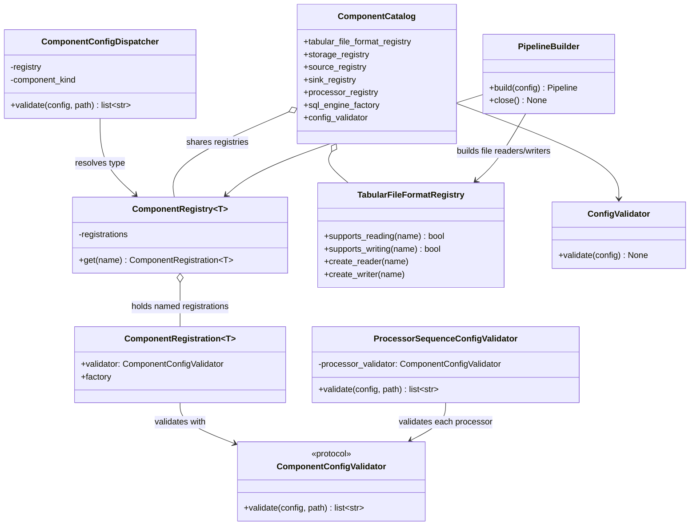

# Component Registry Architecture

## Purpose

ETLRelay 0.6.0 uses explicit registries to associate each supported configuration `type` with both its configuration validator and runtime factory. The validator and `PipelineBuilder` consume the same registrations, reducing the risk that a type is accepted during validation but unavailable during construction.

The registry is an internal composition mechanism, not a public dynamic-plugin system. The v0.6.0 default catalog defines a small fixed set of built-in components.

## Supported families

| Family | Registered names | Registry |
|---|---|---|
| Sources | `file`, `sql` | `ComponentRegistry[Source]` |
| Sinks | `file`, `sql` | `ComponentRegistry[Sink]` |
| Storage | `local` | `ComponentRegistry[FileSystem]` |
| Processors | `select_columns`, `rename_columns`, `filter_rows` | `ComponentRegistry[Processor]` |
| Tabular formats | `csv`, `parquet` | `TabularFileFormatRegistry`, with independent read/write capabilities |
| Configuration document formats | `yaml` | `KeyValueReader` implementation; not part of the tabular format registry |

Tabular formats are separate because a format can support reading, writing, or both. The format registry exposes capability queries without constructing readers/writers. YAML reads a mapping-shaped configuration document, not a stream of tabular `Batch` objects.

## Registration and dispatch

A `ComponentRegistration[T]` associates a `ComponentConfigValidator` with the factory used to build a component of type `T`. A `ComponentRegistry[T]` holds the explicit names and registrations for one family. Its lookup operation returns a registration or raises the registry's documented lookup error; it does not invoke the registration's factory.

The common `ComponentConfigDispatcher` checks mapping shape and the component `type`, then delegates validation through the matching registration. `SourceConfigValidator`, `SinkConfigValidator`, `StorageConfigValidator`, and `ProcessorConfigValidator` specialize this shared dispatch behavior with the appropriate registry and component-kind label. `ProcessorSequenceConfigValidator` validates the ordered list and delegates each element to the processor dispatcher with an indexed path.

Component-specific validators own their own property schema. The dispatcher does not contain `file`, `sql`, `local`, or processor-specific fields and never constructs runtime components.

## Default composition root

`create_default_component_catalog()` in `etlrelay.default_component` creates the shared registrations and services. It wires them in dependency order:

1. Create the `TabularFileFormatRegistry` with CSV and Parquet readers and writers.
2. Create the local storage registry and storage dispatcher.
3. Create source and sink registrations that share the same storage and format registries where applicable.
4. Create processor registrations pairing `SelectColumns`, `RenameColumns`, and `FilterRows` validators with their factories.
5. Create source, sink, processor, and processor-sequence dispatchers.
6. Create the root `ConfigValidator` and expose the shared objects through `ComponentCatalog`.

The caller may inject a `SqlEngineFactory`; otherwise the catalog creates one. The same SQL engine factory is injected into the built-in SQL source and sink factories and is exposed through the catalog for the builder's resource lifecycle.

Catalog creation instantiates registrations, validator objects, and factory objects. It does not call component factory `build()` methods, resolve SQL environment variables, create database engines, open data resources, or execute a pipeline.

## Pipeline construction

`PipelineBuilder` receives the source, sink, and processor registries from the same catalog. It resolves all registrations before SQL environment preflight or component construction. The order is deliberate: a configuration with an unknown component type or missing SQL URL must fail before any ETL component factory runs.

After all registrations and SQL references pass preflight, the builder constructs the source, processors in YAML order, and sink. It returns a `Pipeline` without executing it. If construction fails after SQL engines have been acquired during that attempt, the builder attempts to close the shared factory while preserving the original construction exception. On successful execution, the caller explicitly calls `builder.close()` to dispose the engines owned by the shared factory.

## Extension policy

Adding support for a component requires a runtime implementation, its component-specific configuration validator and factory, and one explicit registration in the default composition. It should not require changes to the generic registry, common dispatcher, unrelated validators, or `ConfigValidator` root rules, provided the root schema and supported component contract remain the same.

No automatic discovery, import-by-string, reflection-based construction, arbitrary user code execution, or mutable global service locator is provided in v0.6.0. New types must be intentionally added to the built-in configuration contract.

## Related documentation

- [YAML Configuration](../configuration.md) — user-visible schema and supported combinations.
- [Configuration Loading Architecture](configuration-loading.md) — parsing, validation, building, and execution boundaries.
- [Configuration Validation Architecture](configuration-validation.md) — validator responsibilities and errors.

## Class diagram: registrations, dispatch, and composition

The diagram below summarizes the principal types and dependencies described on this page. Existing flow, sequence, and data-flow diagrams remain part of this document.

