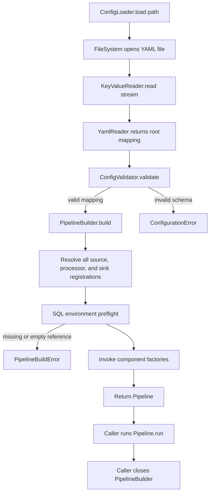
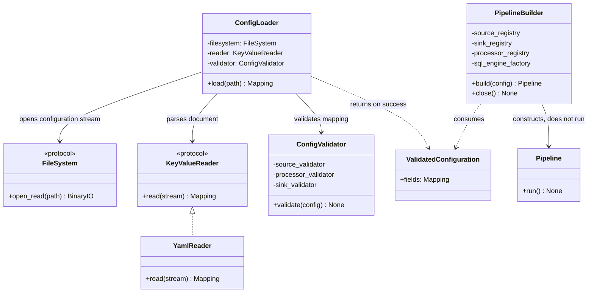

# Configuration Loading Architecture

## Purpose

ETLRelay separates configuration-document parsing, schema validation,
component construction, and pipeline execution.

`ConfigLoader` and `ConfigValidator` establish the configuration contract.
`PipelineBuilder` resolves explicit component registrations, preflights
required SQL environment-variable references, and constructs runtime
components.

The pipeline executes only when the caller invokes `Pipeline.run()`.

These responsibilities are shared by the direct Python APIs and the
`etlrelay` CLI. Schema version `1` remains the supported configuration
format in ETLRelay v0.8.0.

## End-to-end boundary

The configuration document itself has to be read. The no-side-effects guarantee concerns the configured ETL pipeline: schema validation does not open source/sink data files, connect to a database, create SQLAlchemy engines, invoke ETL component factories, or execute a pipeline. SQL URL environment variables are resolved during builder preflight; engines are created lazily when SQL component factories request them after successful preflight.

## Responsibilities

### `KeyValueReader` and `YamlReader`

`KeyValueReader` is a format-independent protocol for reading one mapping-shaped document from a binary stream. It is distinct from the tabular `TabularReader` protocol, which produces an iterable of ETLRelay `Batch` objects.

`YamlReader` lives in `etlrelay.readers.yaml`. It uses a safe PyYAML loader, rejects duplicate mapping keys (including duplicates after merge-key flattening), requires one document whose root is a mapping, and requires string keys at the root. It does not know ETLRelay's allowed configuration fields and does not perform application-schema validation. `YamlReader` leaves the supplied stream lifecycle to its caller.

### `ConfigLoader`

`ConfigLoader` receives a `FileSystem`, a `KeyValueReader`, and a `ConfigValidator`. `load(path)` opens the configuration resource through the injected filesystem, passes the stream to the reader within a context manager, validates the parsed object, and returns the mapping on success. It does not select a reader by file extension, construct components, resolve SQL variables, create engines, build a pipeline, or execute it.

`ConfigLoader` does not broadly translate exceptions. YAML parsing errors and filesystem errors propagate in their own exception types; schema validation failures are reported by `ConfigurationError`.

### `ConfigValidator`

`ConfigValidator` checks root-level properties and schema version `1`, then delegates to the source, processor-sequence, and sink validators. Root values must be mappings with string keys. The root keys must be exactly `version`, `source`, `processors`, and `sink`, all required. The integer version check explicitly rejects YAML Boolean `true`.

Leaf and family validators return path-qualified error strings. `ConfigValidator.validate()` raises `ConfigurationError` when the root checks or any delegated validation produces errors; on success it returns `None`. The parsed mapping is returned by `ConfigLoader.load()`, not by the validator.

### `PipelineBuilder`

`PipelineBuilder` consumes validated configuration. It first resolves all source, sink, and processor registrations; then it collects SQL environment-variable references from configured SQL sources/sinks and performs preflight. It invokes component factories only after those steps succeed. Processors are constructed in YAML order.

The builder returns a `Pipeline` but does not execute it. With the default catalog, SQL source and sink factories share the catalog's `SqlEngineFactory`. Once the pipeline finishes, the caller calls `builder.close()` to dispose factory-owned engines and discard resolved URLs. Direct Python `SqlSource`/`SqlSink` usage retains the direct API's caller-owned engine lifecycle.

If component construction fails after SQL engines have been created in that build attempt, the builder attempts cleanup and preserves the original construction exception. A successful build must not close SQL resources before pipeline execution.

## Why parsing and validation are separate

A mapping document format reader knows YAML syntax, duplicate keys, document count, and root shape. The validator knows the ETLRelay schema—allowed component types, property names, property types, required fields, and schema version. Keeping these responsibilities separate permits a future mapping reader (such as JSON) without making it responsible for ETLRelay component names.

A future document format does not need to be part of the tabular `TabularFileFormatRegistry`. That registry is specifically about the ability to read and/or write tabular batches in CSV, Parquet, or another future tabular format.

## Error boundaries

| Boundary | Examples | Error behavior |
|---|---|---|
| YAML parsing / shape | Malformed YAML, duplicate mapping keys, multiple documents | PyYAML error or `ValueError` from `YamlReader` for root-shape violations. |
| Root and component schema | Unsupported version, missing/unknown fields, invalid field types | `ConfigurationError` raised by `ConfigValidator`. |
| Build and preflight | Unsupported/unregistered types, missing or empty SQL environment variables | `PipelineBuildError`. |
| Runtime execution | File, query, schema, processor, or sink failures | Underlying runtime exceptions propagate unless a component contract explicitly translates them. |

## Scope

The supported configuration workflow includes YAML loading, schema
validation, explicit component registration, SQL connection-reference
preflight, runtime pipeline construction, and execution through the
Python API or CLI.

The implementation does not support arbitrary dynamic imports,
unrestricted Python expression evaluation, automatic plugin discovery,
configuration inheritance, templating, or JSON configuration loading.

The configuration schema does not provide scheduling, distributed
execution, or a general-purpose extension system.

Preflight guarantees apply to registration resolution and the required
SQL environment-variable references. They do not establish runtime
filesystem availability, database connectivity, SQL authorization,
input-data compatibility, or successful output persistence.

For CLI behavior and exit codes, see the
[CLI Reference](../cli-reference.md).

## Class diagram: loading, validation, building, and execution

The diagram below summarizes the principal types and dependencies described on this page. Existing flow, sequence, and data-flow diagrams remain part of this document.

