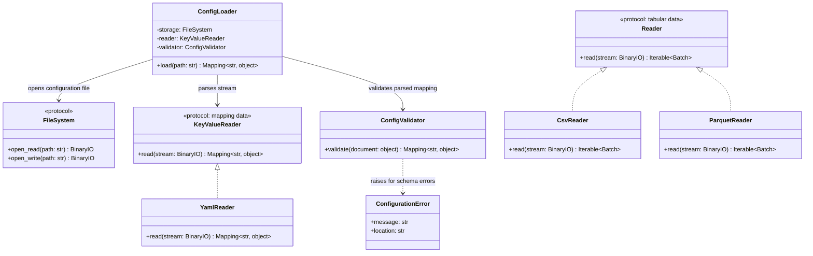

# Configuration Loading

## Purpose

The configuration-loading layer reads a configuration document, parses it into mapping-shaped data, and validates it against ETLRelay's declared configuration contract. It stops at validated configuration data: it does not construct sources, processors, sinks, SQLAlchemy engines, or pipelines.

The design separates three responsibilities:

- `KeyValueReader` defines a format-independent contract for reading mapping-shaped data from a binary stream.
- `YamlReader` implements that contract for YAML. It belongs with format readers and does not know the ETLRelay configuration schema.
- `ConfigLoader` coordinates file access, parsing, and validation. `ConfigValidator` checks the ETLRelay schema and reports configuration-specific errors.

This separation permits a future JSON reader to replace `YamlReader` without changing `ConfigLoader`. It also keeps YAML parsing distinct from configuration-schema validation and from the pipeline-construction work planned for the following ticket.

## Class Diagram



The diagram shows the intended contracts and dependencies. It does not imply that these new configuration modules have already been implemented.

## Responsibilities

### `KeyValueReader`

`KeyValueReader` is a protocol for format readers whose output is mapping-shaped data. It is separate from the existing tabular `Reader` protocol, whose output is an iterable of ETLRelay `Batch` objects.

Its contract is deliberately small: accept an already-open binary stream and return a mapping with string keys. It does not know about ETLRelay's fields such as `version`, `source`, `processors`, or `sink`.

A reader must reject a document that cannot satisfy this mapping-shaped output contract. For YAML, this includes malformed YAML, duplicate mapping keys, multiple documents where one document is expected, and a root value that is not a mapping. Parser errors should retain useful source-location information when the underlying parser provides it.

### `YamlReader`

`YamlReader` parses one YAML document using a safe loader. It implements `KeyValueReader` and returns the resulting root mapping.

`YamlReader` is responsible for format-level concerns only:

- parsing YAML from a binary stream;
- avoiding arbitrary Python object construction;
- rejecting duplicate keys rather than silently accepting ambiguous values;
- requiring one root mapping suitable for the `KeyValueReader` contract;
- reporting syntax or document-shape errors with useful context.

`YamlReader` is **not** responsible for validating ETLRelay configuration properties, selecting components, resolving environment variables, opening source or sink resources, or building pipelines. It must not import the configuration package merely to implement the reader contract.

### `ConfigLoader`

`ConfigLoader` coordinates configuration loading. It receives a `FileSystem`, a `KeyValueReader`, and a `ConfigValidator` through its constructor.

Its `load(path)` operation:

1. Opens the configuration file using `FileSystem.open_read(path)`.
2. Passes the stream to `KeyValueReader.read(stream)`.
3. Closes the stream reliably when parsing completes or raises.
4. Passes the returned mapping to `ConfigValidator.validate(document)`.
5. Returns the validated mapping.

`ConfigLoader` does not instantiate readers based on a filename extension, infer configuration types, construct ETL components, create SQLAlchemy engines, or execute a pipeline. Selection of the concrete reader belongs to the caller or a later CLI entry point. This avoids introducing a factory or registry for a single format.

The loader should not wrap every exception indiscriminately. File-system errors should retain their original meaning; YAML parsing errors should retain the parser's actionable source information; schema errors should use `ConfigurationError`.

### `ConfigValidator`

`ConfigValidator` validates the mapping-shaped input against configuration schema version 1. It is a class implementation, consistent with the rest of ETLRelay, but it does not need an inheritance hierarchy or a separate validation framework.

The validator is responsible for:

- requiring `version`, `source`, `processors`, and `sink`;
- requiring `version` to be an integer equal to `1` (a YAML boolean such as `true` is not version `1`);
- rejecting unknown top-level fields and unsupported component properties;
- validating source, sink, storage, format, and processor types and fields;
- rejecting unknown component types and unsupported formats;
- checking processor property shape, allowed filter operators, and unique `select_columns` entries;
- reporting the location of the invalid property;
- preserving the input configuration rather than silently changing its meaning.

The validator must not open files, access the network, read environment-variable values, connect to databases, instantiate components, or run pipeline code. Environment-variable names can be validated as configuration values; checking that they resolve to non-empty connection URLs belongs in the subsequent pipeline-building boundary, before any component or engine is constructed.

The validator cannot establish data-dependent conditions such as whether a selected column exists in the input schema, whether a SQL query is accepted by a database, or whether a destination table accepts the processed columns. Those remain runtime or integration concerns.

### `ConfigurationError`

`ConfigurationError` represents a schema-validation failure. It should include a human-readable message and a location such as `source.storage.type` or `processors[0].operator`.

It is not intended to replace errors from the YAML parser or filesystem. Those errors should retain their original type and diagnostic details unless a later, concrete caller requirement justifies a carefully scoped translation layer.

## Dependency Relationship

```text
ConfigLoader
├── FileSystem
│   └── LocalFileSystem
│       └── PathValidator
├── KeyValueReader
│   └── YamlReader
└── ConfigValidator
    └── ConfigurationError
```

`ConfigLoader` depends on the `KeyValueReader` abstraction, not `YamlReader`. The existing `Reader` abstraction remains for tabular formats:

```text
Reader (tabular: Iterable[Batch])
├── CsvReader
└── ParquetReader

KeyValueReader (mapping-shaped data)
└── YamlReader
```

A future `JsonReader` can implement `KeyValueReader` without changing `ConfigLoader`. The configuration schema remains the validator's responsibility regardless of the serialization format.

## Proposed Interfaces

The following signatures document the intended API; they are not a claim that the implementation already exists.

### `KeyValueReader`

```python
from collections.abc import Mapping
from typing import Protocol
from typing import BinaryIO


class KeyValueReader(Protocol):
    """Read mapping-shaped data from a binary stream."""

    def read(self, stream: BinaryIO) -> Mapping[str, object]:
        """Parse one document and return its root mapping."""
        ...
```

### `YamlReader`

```python
from collections.abc import Mapping
from typing import BinaryIO


class YamlReader:
    """Read one safe, mapping-shaped YAML document."""

    def read(self, stream: BinaryIO) -> Mapping[str, object]:
        ...
```

### `ConfigValidator`

```python
from collections.abc import Mapping


class ConfigValidator:
    """Validate a mapping against the supported ETLRelay schema."""

    def validate(self, document: object) -> Mapping[str, object]:
        ...
```

Accepting `object` at the validation boundary permits defensive checks if `ConfigValidator` is called directly with an invalid top-level value. In the normal loader flow, `KeyValueReader` guarantees a root mapping before validation begins.

### `ConfigLoader`

```python
from collections.abc import Mapping

from etlrelay.core import KeyValueReader
from etlrelay.storage import FileSystem


class ConfigLoader:
    def __init__(
        self,
        storage: FileSystem,
        reader: KeyValueReader,
        validator: ConfigValidator,
    ) -> None:
        ...

    def load(self, path: str) -> Mapping[str, object]:
        ...
```

The imports above illustrate dependencies, not exact current package exports. They should be reconciled with ETLRelay's actual public export conventions during implementation.

## Data Flow

```text
ConfigLoader.load("pipeline.yaml")
             |
             v
FileSystem.open_read(path)
             |
             v
       BinaryIO stream
             |
             v
KeyValueReader.read(stream)
             |
             v
     Mapping[str, object]
             |
             v
ConfigValidator.validate(document)
             |
             v
    Validated configuration
```

The configuration file is necessarily opened to read it. The safety guarantee is that malformed or invalid configuration is rejected before opening configured source or sink data files, connecting to databases, constructing source/sink/processor instances, creating SQLAlchemy engines, or running a pipeline.

## Configuration Contract

The schema contract is defined separately in the v0.6.0 configuration contract document. In summary, schema version 1 requires exactly the top-level keys `version`, `source`, `processors`, and `sink`.

Supported component types are:

- Sources: `file`, `sql`.
- Sinks: `file`, `sql`.
- Processors: `select_columns`, `rename_columns`, `filter_rows`.
- Storage: `local`.
- File formats: `csv`, `parquet`.

The `processors` property is required, and an empty list is valid. Closed property sets reject spelling mistakes and unsupported features rather than ignoring them. All four source/sink combinations are schema-valid; runtime query, schema, filesystem, and database constraints are not inferred by schema validation.

## SOLID Considerations

### Single Responsibility Principle

`YamlReader` parses YAML, `ConfigValidator` validates the schema, and `ConfigLoader` coordinates reading and validation. No class owns parsing, schema policy, and pipeline construction together.

### Open/Closed Principle

`ConfigLoader` can work with any `KeyValueReader` implementation. Adding a different serialization format does not require changing the loader. Schema evolution remains explicit through the configuration version and validator rules; a plugin registry is not required.

### Liskov Substitution Principle

Any `KeyValueReader` implementation can replace another if it accepts a binary stream, returns one root mapping with string keys, rejects documents outside that contract, and provides meaningful errors. `YamlReader` does not implement the tabular `Reader` contract because its result is not an iterable of `Batch` objects.

### Interface Segregation Principle

The configuration layer uses a narrow reader protocol for mapping-shaped data and leaves the tabular reader contract intact. It uses ETLRelay's existing `FileSystem` abstraction rather than introducing another storage API just for configuration reads.

### Dependency Inversion Principle

`ConfigLoader` depends on `KeyValueReader`, not `YamlReader`. Both the current YAML reader and a future JSON reader can satisfy the contract without configuration-specific dependencies in their implementations.

## Test Boundaries

Unit tests should be organized by responsibility:

- `tests/unit/readers/test_yaml.py`: safe parsing, malformed YAML, duplicate keys, multiple documents, and non-mapping roots, using in-memory binary streams.
- `tests/unit/config/test_validator.py`: schema version, required fields, property types, unknown properties, unsupported components and formats, processor validation, and actionable property locations.
- `tests/unit/config/test_loader.py`: mocked `FileSystem`, `KeyValueReader`, and validator interactions; stream closure; correct delegation; and propagation of errors.

Loader unit tests should assert that it invokes only the injected reader and validator. They should not instantiate real sources, processors, sinks, engines, or pipelines. A separate builder ticket should own tests for component construction. Later functional and integration tests can exercise real YAML files and real ETL components.

## Design Constraints

Keep the initial implementation limited to:

- one `KeyValueReader` protocol;
- one `YamlReader` implementation using a safe YAML loader;
- one `ConfigValidator` class;
- one `ConfigLoader` class;
- one schema-validation exception with actionable property locations;
- the existing `FileSystem` abstraction.

Do not introduce a generic parser factory, component registry, plugin loader, arbitrary imports, `eval`, configuration inheritance, templating, validation frameworks, JSON support, caching, or YAML writing as part of this ticket.

The central design principle is:

**The reader understands the document format, the validator understands the configuration contract, and the loader coordinates both without constructing or executing a pipeline.**
