# Configuration Loading and Validation Architecture

## Purpose

This document defines the v0.6.0 design for loading a mapping-shaped configuration document and validating it against ETLRelay configuration schema version 1. It supersedes the earlier design in which `ConfigValidator` contained every schema rule in one class.

The design keeps the scope limited to the currently supported components. It uses explicit type-to-validator mappings rather than dynamic discovery, a plugin registry, reflection, or arbitrary Python construction.

## Boundaries

The configuration path is:

1. `ConfigLoader` opens the configuration file through the supplied `FileSystem`.
2. `KeyValueReader` parses one mapping-shaped document from the stream. `YamlReader` is the current implementation.
3. `ConfigValidator` checks the top-level contract and delegates the source, processor sequence, and sink to their validators.
4. Component dispatchers select an explicit validator for each declared component `type`.
5. If validation succeeds, `ConfigLoader` returns the validated mapping. No ETL component is created or executed.

The config file itself must be read. The no-side-effects guarantee means that validation must not open source/sink data files, connect to a database, create SQLAlchemy engines, construct ETL components, or execute a pipeline.

## Class Diagram

```mermaid
classDiagram
    direction TB

    class FileSystem {
        <<protocol>>
        +open_read(path: str) BinaryIO
    }

    class KeyValueReader {
        <<protocol>>
        +read(stream: BinaryIO) Mapping~str, object~
    }

    class YamlReader {
        +read(stream: BinaryIO) Mapping~str, object~
    }

    class ConfigLoader {
        -storage: FileSystem
        -reader: KeyValueReader
        -validator: ConfigValidator
        +load(path: str) Mapping~str, object~
    }

    class ConfigValidator {
        -source_validator: SourceConfigValidator
        -sink_validator: SinkConfigValidator
        -processor_validator: ProcessorSequenceValidator
        +validate(config: object) Mapping~str, object~
    }

    class ComponentConfigValidator {
        <<protocol>>
        +validate(config: object, path: str) list~str~
    }

    class SourceConfigValidator {
        -validators: Mapping
        +validate(config: object, path: str) list~str~
    }

    class SinkConfigValidator {
        -validators: Mapping
        +validate(config: object, path: str) list~str~
    }

    class ProcessorSequenceValidator {
        -validators: Mapping
        +validate(config: object, path: str) list~str~
    }

    class FileSourceConfigValidator {
        -file_component_validator: FileComponentConfigValidator
        +validate(config: object, path: str) list~str~
    }

    class FileSinkConfigValidator {
        -file_component_validator: FileComponentConfigValidator
        +validate(config: object, path: str) list~str~
    }

    class FileComponentConfigValidator {
        -storage_validator: StorageConfigValidator
        +validate(config: object, path: str) list~str~
    }

    class SqlSourceConfigValidator {
        +validate(config: object, path: str) list~str~
    }

    class SqlSinkConfigValidator {
        +validate(config: object, path: str) list~str~
    }

    class SelectColumnsConfigValidator {
        +validate(config: object, path: str) list~str~
    }

    class RenameColumnsConfigValidator {
        +validate(config: object, path: str) list~str~
    }

    class FilterRowsConfigValidator {
        +validate(config: object, path: str) list~str~
    }

    class StorageConfigValidator {
        +validate(config: object, path: str) list~str~
    }

    class ConfigurationError {
        +message: str
    }

    KeyValueReader <|.. YamlReader
    ComponentConfigValidator <|.. SourceConfigValidator
    ComponentConfigValidator <|.. SinkConfigValidator
    ComponentConfigValidator <|.. ProcessorSequenceValidator
    ComponentConfigValidator <|.. FileSourceConfigValidator
    ComponentConfigValidator <|.. FileSinkConfigValidator
    ComponentConfigValidator <|.. FileComponentConfigValidator
    ComponentConfigValidator <|.. SqlSourceConfigValidator
    ComponentConfigValidator <|.. SqlSinkConfigValidator
    ComponentConfigValidator <|.. SelectColumnsConfigValidator
    ComponentConfigValidator <|.. RenameColumnsConfigValidator
    ComponentConfigValidator <|.. FilterRowsConfigValidator
    ComponentConfigValidator <|.. StorageConfigValidator

    ConfigLoader --> FileSystem : reads config file
    ConfigLoader --> KeyValueReader : parses document
    ConfigLoader --> ConfigValidator : validates document
    ConfigValidator --> SourceConfigValidator
    ConfigValidator --> SinkConfigValidator
    ConfigValidator --> ProcessorSequenceValidator
    SourceConfigValidator o--> ComponentConfigValidator : explicit source type mapping
    SinkConfigValidator o--> ComponentConfigValidator : explicit sink type mapping
    ProcessorSequenceValidator o--> ComponentConfigValidator : explicit processor type mapping
    FileSourceConfigValidator --> FileComponentConfigValidator : shared file fields
    FileSinkConfigValidator --> FileComponentConfigValidator : shared file fields
    FileComponentConfigValidator --> StorageConfigValidator
    ConfigValidator ..> ConfigurationError : raises aggregated errors
```



The shared protocol provides one narrow interface for validators that accept a configuration value and its location, returning zero or more actionable error messages. `ProcessorSequenceValidator` uses the same interface even though its input is a list rather than one component mapping.

## Model Responsibilities

### `KeyValueReader` and `YamlReader`

`KeyValueReader` is a protocol for readers that return one mapping-shaped document. It belongs in `src/etlrelay/core/key_value_reader.py`. `YamlReader` lives in `src/etlrelay/readers/yaml.py` and is responsible for safe YAML parsing, a single document, duplicate-key handling, and the root mapping/string-key contract. It must not know ETLRelay configuration field names.

There is no separate `Parser` class: YAML parsing is the responsibility of `YamlReader`. A future `JsonReader` can implement `KeyValueReader` without changing the configuration validator.

### `ConfigurationError`

`ConfigurationError` lives in `src/etlrelay/config/errors.py`. `ConfigValidator` raises it when schema validation fails. Individual component validators return `list[str]` rather than raising an exception for each invalid property. This allows errors from multiple sections to be aggregated once, with paths such as `source.storage.type` and `processors[0].operator`.

YAML parsing errors and filesystem errors are not converted into `ConfigurationError` by default. They retain their original type and diagnostics.

### `ComponentConfigValidator`

This protocol lives in `src/etlrelay/config/validators/protocol.py`:

```python
class ComponentConfigValidator(Protocol):
    def validate(self, config: object, path: str) -> list[str]: ...
```

The protocol is justified because multiple concrete validators must be dispatched through the same interface. It is not a plugin API and does not require runtime registration or inheritance.

### Type-specific validators and dispatchers

`SourceConfigValidator` and `SinkConfigValidator` are dispatchers. Each verifies that its input is a mapping, validates the `type` discriminator, and delegates to a specific validator via an explicit mapping. `ProcessorSequenceValidator` similarly validates the processor list and dispatches each mapping entry to its matching type-specific validator. Unknown or malformed types produce a path-qualified error rather than a raw `KeyError` or `TypeError`.

Type-specific validators own the schema for their own component:

- `FileSourceConfigValidator`
- `SqlSourceConfigValidator`
- `FileSinkConfigValidator`
- `SqlSinkConfigValidator`
- `SelectColumnsConfigValidator`
- `RenameColumnsConfigValidator`
- `FilterRowsConfigValidator`

`FileSourceConfigValidator` and `FileSinkConfigValidator` use `FileComponentConfigValidator` for their shared `path`, `format`, and `storage` rules. They remain separate classes so source and sink rules can diverge later without changing dispatchers. This shared validator does not open files.

`StorageConfigValidator` validates the storage definition. Schema v1 supports only `type: local` and optional non-empty `base_path`; additional storage-specific validator classes are deferred until another storage backend is actually supported.

`ProcessorSequenceValidator` validates that `processors` is a list, accepts an empty list, validates entries in order, and dispatches directly to the matching processor-specific validator. It supplies index-qualified paths such as `processors[1]`. A separate one-item processor dispatcher is unnecessary because there is no independent use case for it.

### `ConfigValidator`

`ConfigValidator` is the public entry point for schema validation. It validates the top-level mapping, required and unknown fields, and schema version, then delegates source, processor sequence, and sink validation. It aggregates all available messages and raises one `ConfigurationError` if any exist. It does not construct runtime components or resolve environment variables.

`ConfigValidator` can construct the fixed default validator graph while allowing its three section validators to be injected for unit tests. The supported component mappings stay explicit in the default composition.

### `ConfigLoader`

`ConfigLoader` receives `FileSystem`, `KeyValueReader`, and `ConfigValidator` dependencies. It opens the configuration file with a context manager, reads the document, closes the stream, validates the result, and returns the validated mapping. It does not infer formats by filename, create a reader dynamically, instantiate pipeline components, or execute a pipeline.

## Configuration Schema v1

The validator must match the established configuration contract:

- Top level: exactly `version`, `source`, `processors`, and `sink`; all are required.
- Version: an integer equal to `1`; booleans are not accepted as integers.
- File source and sink: required `type`, `path`, `format`, and `storage`; `type` is `file`; format is `csv` or `parquet`; storage has `type: local` and optional `base_path`.
- SQL source: required `type`, `connection_url_env`, and `query`; optional `parameters` mapping. Parameter values are scalar strings, integers, floats, booleans, or null.
- SQL sink: required `type`, `connection_url_env`, and `table_name`; optional `schema`.
- `select_columns`: required `columns` list of strings; names must be unique.
- `rename_columns`: required `mapping` of string column names to string column names.
- `filter_rows`: required non-empty `column`, supported `operator` (`==`, `!=`, `<`, `<=`, `>`, `>=`), and a string/integer/float/boolean `value` (null is not permitted).
- Each component has a closed set of properties; unknown fields are errors.
- An empty `processors: []` is valid.

Validation checks configuration shape and types only. It does not inspect actual file contents, determine whether column names exist in input data, execute SQL, confirm the destination table exists, or prove that a filesystem path is accessible.

## Models and Direct Dependencies

| Model | Proposed module | Direct dependencies | Unit-test approach |
|---|---|---|---|
| `KeyValueReader` | `core/key_value_reader.py` | None; protocol only | Pyright checks conformance; `YamlReader` behavior is covered by its existing tests. |
| `ComponentConfigValidator` | `config/validators/protocol.py` | None; protocol only | No standalone runtime test; concrete validators are type-checked against it. |
| `StorageConfigValidator` | `config/validators/storage.py` | None beyond the protocol | Test directly using plain mappings. |
| `FileComponentConfigValidator` | `config/validators/file_component.py` | `StorageConfigValidator` | Mock the storage validator. |
| `FileSourceConfigValidator` | `config/validators/file_source.py` | `FileComponentConfigValidator` | Mock the shared file-properties validator. |
| `SqlSourceConfigValidator` | `config/validators/sql_source.py` | None beyond the protocol | Test directly using plain mappings. |
| `SourceConfigValidator` | `config/validators/source.py` | Explicit mapping of `file` and `sql` validators | Mock each mapped validator and assert dispatch. |
| `FileSinkConfigValidator` | `config/validators/file_sink.py` | `FileComponentConfigValidator` | Mock the shared file-properties validator. |
| `SqlSinkConfigValidator` | `config/validators/sql_sink.py` | None beyond the protocol | Test directly using plain mappings. |
| `SinkConfigValidator` | `config/validators/sink.py` | Explicit mapping of `file` and `sql` validators | Mock each mapped validator and assert dispatch. |
| `SelectColumnsConfigValidator` | `config/validators/select_columns.py` | None beyond the protocol | Test directly using plain mappings. |
| `RenameColumnsConfigValidator` | `config/validators/rename_columns.py` | None beyond the protocol | Test directly using plain mappings. |
| `FilterRowsConfigValidator` | `config/validators/filter_rows.py` | None beyond the protocol | Test directly using plain mappings. |
| `ProcessorSequenceValidator` | `config/validators/processor_sequence.py` | Explicit mapping of the three processor validators | Mock the mapped validators and assert dispatch, ordering, and index-qualified paths. |
| `ConfigValidator` | `config/validator.py` | Source, sink, and processor-sequence validators; `ConfigurationError` | Mock the three section validators. |
| `ConfigLoader` | `config/loader.py` | `FileSystem`, `KeyValueReader`, `ConfigValidator` | Mock all collaborators; use an in-memory stream to check closure. |

`ConfigurationError` already exists in `config/errors.py` and is not a new validator model. Keep its contract small: it represents aggregate configuration-schema failures. Leaf validators return strings; they do not create one exception per error.

## Dependency Order and Implementation Plan

The implementation and TDD sequence follows the dependency graph from leaf validators to the public loader:

1. Confirm the existing `ConfigurationError` contract and add `ComponentConfigValidator` protocol.
2. `StorageConfigValidator`.
3. `FileComponentConfigValidator`.
4. Type-specific source validators: `FileSourceConfigValidator`, `SqlSourceConfigValidator`.
5. `SourceConfigValidator` dispatcher.
6. Type-specific sink validators: `FileSinkConfigValidator`, `SqlSinkConfigValidator`.
7. `SinkConfigValidator` dispatcher.
8. Processor validators: `SelectColumnsConfigValidator`, `RenameColumnsConfigValidator`, `FilterRowsConfigValidator`.
9. `ProcessorSequenceValidator` with explicit dispatch to the three processor validators.
10. `ConfigValidator` root validation, composition, and error aggregation.
11. `ConfigLoader` file/read/validate orchestration.

The protocol has no meaningful standalone runtime behavior to unit-test; its shape is checked by Pyright through concrete implementations. Existing `YamlReader` unit tests cover the reader's behavior. Do not test the whole default object graph by composing real validators in these unit tests; that belongs in a later functional test. Unit tests for each validator should test it directly and mock downstream validators at composition boundaries.

## Testing Contract

- Leaf validators use plain Python values and do not access files, databases, environment variables, or ETL components.
- Dispatchers use mocked `ComponentConfigValidator` instances and assert the correct validator receives the original object and exact path.
- `ConfigValidator` uses mocked source, sink, and processor-sequence validators. These tests cover ordering, aggregation, missing sections, and version/top-level rules without running real child validators.
- `ConfigLoader` uses mocks for `FileSystem`, `KeyValueReader`, and `ConfigValidator`. It verifies context-managed stream closure, delegation order, return value, and exception propagation. It must never build or execute a pipeline.
- Functional/integration tests using actual validator composition and real filesystem/reader behavior are deferred until the relevant feature integration ticket.

## SOLID and Scope

- **Single Responsibility:** section dispatchers select validators; type-specific validators validate one schema; `ConfigValidator` coordinates; `ConfigLoader` performs loading orchestration.
- **Open/Closed:** adding a supported type means implementing its validator and adding one explicit mapping entry. Existing component rules do not absorb its field logic.
- **Liskov Substitution:** validators conform to the same `validate(config, path) -> list[str]` protocol. Dispatchers do not rely on concrete implementation details.
- **Interface Segregation:** validation components use a narrow protocol, not the data-reader or pipeline contracts.
- **Dependency Inversion:** `ConfigLoader` depends on `KeyValueReader`, `FileSystem`, and `ConfigValidator`; dispatchers depend on validator contracts rather than runtime ETL sources/sinks/processors.

Intentionally excluded: a generic schema engine, JSON Schema/Pydantic dependency, auto-discovery, plugin registration, arbitrary imports, expression evaluation, filesystem/network checks, database connectivity checks, and runtime component construction.
