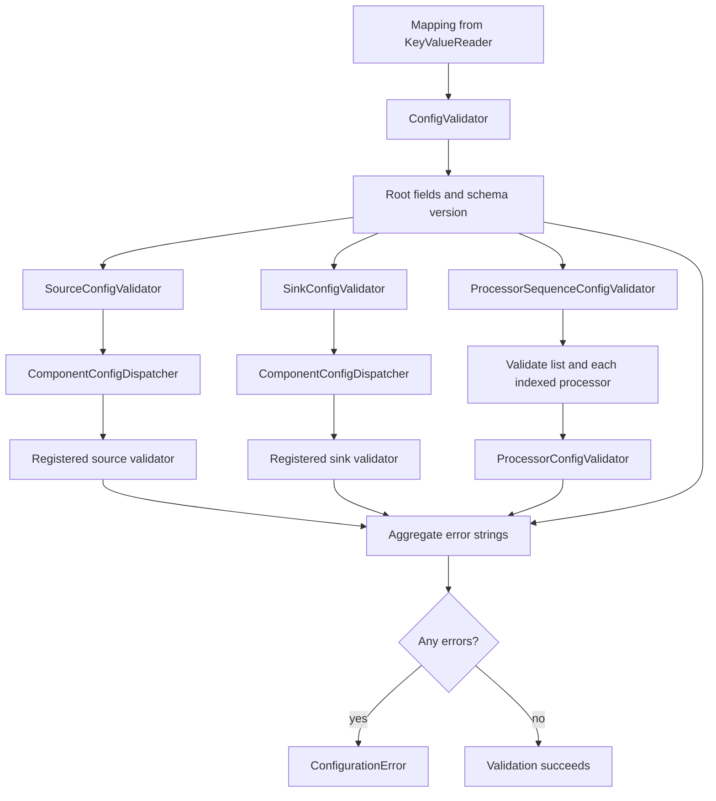
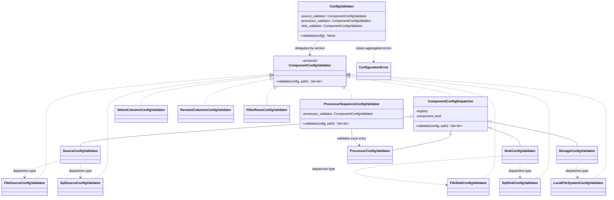

# Configuration Validation Architecture

## Purpose

ETLRelay validates schema-version-1 configuration before runtime
components are constructed.

Validation uses explicit component registrations and component-specific
validators. It does not use dynamic component discovery, arbitrary Python
imports, or Python expression evaluation.

ETLRelay v0.8.0 retains the version-1 configuration schema while
strengthening SQL connection-reference validation and documenting the
limits of configuration preflight.

See [YAML Configuration](../configuration.md) for the supported
component and property contract.

## Validation layers

## Root schema validator

`ConfigValidator` accepts an object so it can defensively validate calls made outside the usual loader. It requires a mapping with string keys, rejects unknown top-level fields, requires `version`, `source`, `processors`, and `sink`, and requires the actual integer `1` for `version`—a Boolean is not accepted even though `bool` is an `int` subclass in Python.

When the root object cannot safely be interpreted as a string-keyed mapping, the validator raises `ConfigurationError` before delegating to section validators. Otherwise it checks root fields and delegates each present section to the injected source, processor-sequence, and sink validators. Errors are aggregated into one `ConfigurationError` rather than raising for each ordinary invalid property.

## Validator contract

`ComponentConfigValidator` is a `Protocol` exposing `validate(config: object, path: str) -> list[str]`. Concrete component validators return path-qualified error strings. An empty list indicates that no validation errors were found; a normal schema failure is not represented by an exception at the leaf-validator level.

This shared protocol applies to source/sink/storage dispatch and individual processors. The processor-sequence validator uses the same protocol to validate each list element.

## Dispatch and leaf validators

`ComponentConfigDispatcher` is the common dispatcher used by `SourceConfigValidator`, `SinkConfigValidator`, `StorageConfigValidator`, and `ProcessorConfigValidator`. It validates that the component configuration is a mapping with string keys, checks that `type` is a non-empty string, looks up the registration in its registry, and delegates to the registered validator. Invalid or unregistered types return path-specific validation messages. Validation does not invoke component factories.

Leaf validators own their own property rules:

- File source: required `path`, `format`, and nested `storage`; the format registry must support reading.
- File sink: required `path`, `format`, and nested `storage`; the format registry must support writing.
- SQL source: `connection_url_env` must be a valid environment-variable
  identifier; `query` must be a nonempty string. Optional `parameters`
  must map string keys to supported scalar values or `None`.
- SQL sink: `connection_url_env` must be a valid environment-variable
  identifier; `table_name` must be a nonempty string. Optional `schema`
  must be a nonempty string.
- Local storage: `type: local`; optional `base_path` must be a non-empty string when present.
- `select_columns`: required list of unique strings.
- `rename_columns`: required mapping with string keys and values; data-dependent source/final-name constraints remain at processing time.
- `filter_rows`: required non-empty column name, one of six supported comparison operators, and a string/integer/float/Boolean value (no `null`).

File source/sink validators share the storage validator and tabular file-format registry. They do not open data files. Format validation checks registry capabilities without constructing readers or writers.

## Processor sequence validation

`ProcessorSequenceConfigValidator` requires a list and accepts an empty list. It visits each element in order and delegates to the processor dispatcher using paths such as `processors[0]` and `processors[1]`. Errors from an invalid element do not stop later elements from being validated. A missing root `processors` property is a root-level error; it is not equivalent to an empty list.

## Schema validation versus runtime validation

Configuration validation can check that a column list contains unique strings, but it cannot establish whether the source data contains those column names. It can check that a SQL query string and scalar parameters have supported types, but it does not execute the query. It can check a table-name string, but it does not connect to a database or verify that the destination table exists. Similarly, local path syntax/containment validation does not prove that the data file exists or is accessible.

Environment-variable names are part of the configuration and can be checked for shape during schema validation. Whether a connection-variable name resolves to a non-empty value is checked by `PipelineBuilder`'s SQL preflight, before component factory construction and source/sink I/O.

The SQL configuration validators check the syntax of
`connection_url_env`, not the contents of the referenced environment
variable.

`PipelineBuilder` checks required variable presence and nonempty values
during preflight before invoking component factories.

Neither stage guarantees that the resolved connection URL is valid,
that a database can be reached, or that the database account has
permission to execute the configured operations.

Actual query execution, destination column compatibility, and database
constraints remain runtime responsibilities.

## Representative errors

| Invalid configuration | Example diagnostic |
|---|---|
| Unsupported version | `version must be the integer 1.` |
| Unknown field | `source.fomrat is not a supported field.` |
| Missing discriminator | `source.type is required.` |
| Unsupported format | `sink.format 'xlsx' is not supported for writing.` |
| Invalid processor operator | `processors[0].operator must be one of '==', '!=', '<', '<=', '>', '>='.` |

Component validators aggregate ordinary validation errors as lists. `ConfigValidator` raises `ConfigurationError` with collected errors. Exact exception rendering depends on the exception's implemented string representation; the messages above illustrate the underlying validation diagnostics.

## Test responsibilities

- Leaf-validator unit tests use plain values and do not open files or connect to databases.
- Dispatcher tests use fake/mocked registrations and assert the correct validator receives the original configuration and exact path.
- Processor-sequence tests cover empty lists, non-lists, ordered indexed paths, and aggregation across multiple invalid entries.
- Root-validator tests cover string-keyed mappings, required/unknown fields, strict integer version handling, delegation order, and aggregated errors.
- Integration/functional tests exercise the actual default catalog and YAML loader; pipeline-builder tests separately verify preflight and no component construction on early failure.

See [Configuration Loading Architecture](configuration-loading.md) and [Component Registry Architecture](component-registry.md).

## Class diagram: schema validation and component dispatch

The diagram below summarizes the principal types and dependencies described on this page. Existing flow, sequence, and data-flow diagrams remain part of this document.

