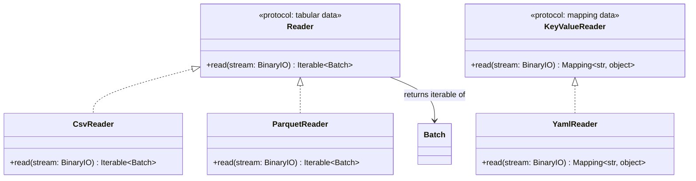

# Data Reader Contracts

## Purpose

ETLRelay reads more than one kind of data shape. The existing CSV and Parquet readers produce tabular data represented by `Batch`. YAML configuration requires a different result: mapping-shaped key-value data.

The project should keep those contracts distinct. Reusing one `Reader` protocol for both would weaken its type contract and make callers handle unrelated return shapes. For v0.6.0, retain the existing tabular `Reader` and introduce a small `KeyValueReader` protocol for mapping-shaped documents.

This document records the distinction needed for the current configuration feature. It does not commit ETLRelay to a general structured-data framework or to JSON support in v0.6.0.

## Contracts Diagram



## Tabular `Reader`

The existing `Reader` contract remains unchanged. It reads a stream and produces an iterable of ETLRelay `Batch` objects.

Examples include:

- `CsvReader`, which parses CSV data into batches;
- `ParquetReader`, which reads Parquet data into batches.

These readers participate in file-source processing. They are coupled to ETLRelay's tabular data model because their responsibility is to supply batches to a pipeline.

## `KeyValueReader`

`KeyValueReader` is a separate protocol for a reader that parses one mapping-shaped document from a binary stream.

Proposed contract:

```python
from collections.abc import Mapping
from typing import BinaryIO, Protocol


class KeyValueReader(Protocol):
    def read(self, stream: BinaryIO) -> Mapping[str, object]:
        ...
```

Contract expectations:

- The reader accepts an already-open binary stream and does not own the stream's lifetime.
- It reads one document.
- It returns a root mapping with string keys; nested values can be mappings, lists, or supported scalar values as appropriate for the format.
- It does not impose ETLRelay configuration field names or schema versions.
- It rejects syntax errors, ambiguous duplicate root/nested mapping keys where the format permits them, or document shapes incompatible with its mapping-return contract.
- It does not construct ETL components or perform I/O beyond consuming the supplied stream.

The exact accepted scalar types and duplicate-key behavior should be documented and tested by each concrete format reader so that a future implementation has an explicit compatibility contract.

## `YamlReader`

`YamlReader` belongs in the general format-reader package (proposed location: `src/etlrelay/readers/yaml.py`), not in `src/etlrelay/config/`. It implements `KeyValueReader` by safely parsing YAML and returning a mapping.

The reader should use a safe loader, reject duplicate mapping keys instead of silently selecting one, reject multiple YAML documents in a single read, and provide source-location details for malformed YAML when available.

It should not know that ETLRelay configuration uses `version`, `source`, `processors`, or `sink`. The validator owns those schema rules. This is the main separation that allows other mapping-oriented use cases to reuse the YAML reader later.

## Configuration Uses the Abstraction

The configuration loader receives a `KeyValueReader` dependency rather than a `YamlReader` dependency. In the v0.6.0 application path, the caller supplies `YamlReader`; the loader does not infer the reader from the file extension or instantiate it dynamically.

```text
ConfigLoader
    |
    +-- FileSystem.open_read(path)
    |
    +-- KeyValueReader.read(stream)
    |       |
    |       +-- current: YamlReader
    |       +-- future: JsonReader (not in v0.6.0 scope)
    |
    +-- ConfigValidator.validate(mapping)
    |
    +-- returns validated configuration mapping
```

The serialization format and the configuration schema are independent. A JSON document that produces the same mapping can be validated against the same schema without modifying `ConfigValidator` or `ConfigLoader`.

## Future Key-Value Writing

A future `KeyValueWriter` protocol could provide the counterpart for serializing mapping-shaped data to a binary stream. A `YamlWriter` or `JsonWriter` could implement that contract if a concrete ETLRelay use case requires it.

That protocol and writer implementations are intentionally deferred until a real writing requirement exists. The current configuration-loading ticket needs only read support; adding an unused writer abstraction would increase surface area without improving the current feature.

## SOLID Considerations

### Single Responsibility Principle

`Reader` focuses on tabular formats, while `KeyValueReader` focuses on mapping-shaped documents. `YamlReader` parses a format but does not validate application schemas.

### Open/Closed Principle

New implementations can be added against `KeyValueReader` without changing `ConfigLoader`. No registry or dynamic format discovery is required for the initial YAML-only workflow.

### Liskov Substitution Principle

A `KeyValueReader` implementation must preserve the mapping-shaped return contract and stream-ownership rules. A tabular `Reader` is not substitutable because it returns batches instead of a mapping.

### Interface Segregation Principle

Callers choose the reader contract matching the data shape they consume. Configuration-loading code does not have to depend on batch iteration, and tabular pipeline code does not have to handle dictionaries as alternate outputs.

### Dependency Inversion Principle

`ConfigLoader` depends on `KeyValueReader`, not a concrete serialization format. Format readers depend on the reader protocol and stream abstraction, not on the configuration schema.

## Scope

Included in v0.6.0:

- the `KeyValueReader` protocol;
- the YAML mapping reader required by configuration loading;
- unit tests for its parsing and mapping-return contract.

Deferred until justified by a concrete post-v1.0 requirement:

- `KeyValueWriter` and YAML writing;
- JSON readers/writers;
- support for arbitrary YAML documents outside the mapping-shaped contract;
- a generalized structured-data serialization framework;
- reader registries, plugin discovery, or format inference.
