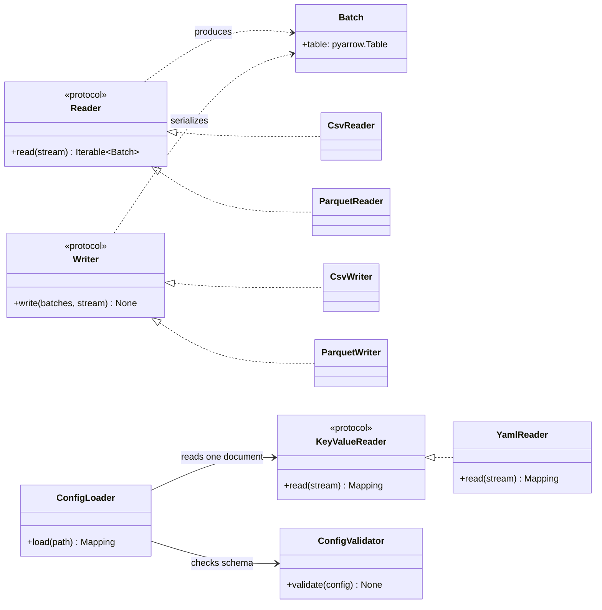

# Data Representation Contracts

## Status and scope

**Implemented in v0.6.0:** `KeyValueReader` and `YamlReader` provide the mapping-shaped configuration-document boundary. The existing `Reader` and `Writer` protocols remain tabular-data contracts in this release.

**Deferred API review:** renaming the tabular protocols to `TabularReader`/`TabularWriter` before `1.0.0`, and deciding whether concrete row-record conversion utilities are justified. This page distinguishes existing behavior from deferred proposals.

## Three distinct representations

### Tabular batches

ETLRelay uses `Batch` objects, backed by PyArrow tables, as the common in-memory tabular representation. The current `Reader` protocol reads a binary stream and returns an iterable of batches; `Writer` serializes an iterable of batches to a binary stream.

```python
from collections.abc import Iterable
from typing import BinaryIO, Protocol

from etlrelay.core import Batch


class Reader(Protocol):
    def read(self, stream: BinaryIO) -> Iterable[Batch]:
        ...


class Writer(Protocol):
    def write(self, batches: Iterable[Batch], stream: BinaryIO) -> None:
        ...
```

These are the current protocol names. The roadmap may rename them to make their tabular role more explicit, but that naming change is not part of v0.6.0.

### Mapping-shaped documents

`KeyValueReader` reads one document mapping from a binary stream. `YamlReader` is the current implementation, using a safe loader and checking that the document root is a mapping with string keys. It rejects duplicate keys and multiple documents. It does not know the application schema.

```python
from collections.abc import Mapping
from typing import BinaryIO, Protocol


class KeyValueReader(Protocol):
    def read(self, stream: BinaryIO) -> Mapping[str, object]:
        ...
```

`ConfigLoader` depends on `KeyValueReader`, not directly on `YamlReader`. `ConfigValidator` then applies the ETLRelay versioned schema, while `PipelineBuilder` consumes the validated configuration and constructs runtime components. The YAML reader never produces `Batch` objects and is not part of the tabular format registry.

### Row records

A row record is an in-memory mapping such as `{"id": 1, "name": "Ada"}`. A sequence of such mappings is different from one configuration mapping and from an iterable of `Batch` objects. ETLRelay does not introduce a general conversion framework between these representations in v0.6.0.

## Configuration loading boundary

```text
Config file
    │
    ▼
FileSystem.open_read(path)
    │
    ▼
Binary stream
    │
    ▼
KeyValueReader.read(stream)  ──> one root Mapping[str, object]
    │
    ▼
ConfigValidator.validate(mapping)
    │
    ▼
Validated mapping
    │
    ▼
PipelineBuilder.build(mapping)  ──> Pipeline
```

The loader must not construct sources, processors, sinks, SQLAlchemy engines, or pipelines. The builder owns component construction and SQL environment preflight. Schema validation and preflight occur before configured source/sink I/O starts.

## Format registry boundaries

`TabularFileFormatRegistry` contains reader and writer factories for tabular formats such as CSV and Parquet. It models reading and writing independently, because a format can be read-only or write-only. The v0.6.0 default catalog registers CSV and Parquet readers/writers.

`YamlReader` is not a tabular format reader. It implements `KeyValueReader` and does not belong in the tabular registry. A future `JsonReader` could satisfy the same document-reader contract without changing the configuration schema, but JSON support is not included in v0.6.0.

## Future tabular/record conversion

Conversion between batches and row mappings may be useful, but it should be implemented only when a concrete use case justifies a stable contract. Before adding such an API, define:

- whether conversion preserves input batch boundaries or may combine/split batches;
- how output schema and data types are supplied or inferred;
- behavior for empty record sequences and inconsistent record keys;
- handling of nulls, nested values, unsupported Arrow types, and conversion loss;
- the record stream type (`list`, iterator, or another explicit contract).

Do not force a cross-representation converter to implement `Processor` if the existing processor contract is `Batch -> Batch`. A converter has a different input/output representation and requires an explicit interface if it is ever introduced.

## Pre-v1.0 naming review

The planned API review may rename `Reader` to `TabularReader` and `Writer` to `TabularWriter` before `1.0.0`. That change should update protocol definitions, concrete type annotations, exports, tests, examples, and docs as one focused change. It should not rename `CsvReader`, `ParquetReader`, `CsvWriter`, or `ParquetWriter` solely for symmetry.

A `KeyValueWriter` is not required for configuration loading and should not be added only for symmetry. Add it only when the project has an actual mapping-document serialization use case.

## Class diagram: tabular data versus mapping-shaped documents

The diagram below summarizes the principal types and dependencies described on this page. Existing flow, sequence, and data-flow diagrams remain part of this document.


