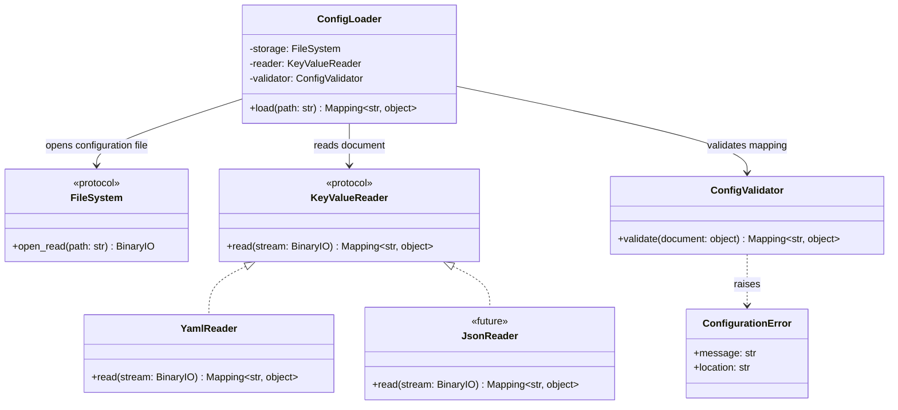

# Data Representation and Reader/Writer Contracts

## Status

**Status:** Design direction recorded for pre-`1.0.0` API review  
**Immediate application:** ETLRelay `0.6.0` YAML configuration  
**Scope:** Contract boundaries and roadmap decisions; this document does not imply that the proposed protocols or components have already been implemented.

## Purpose

ETLRelay currently processes tabular data through `Batch` objects backed by Apache Arrow tables. YAML configuration introduces a second kind of input: a mapping-shaped document containing nested configuration values. These representations have different contracts and should not be forced through one generic reader or writer protocol.

This document records the intended direction before implementation proceeds:

- Clarify that the existing `Reader` and `Writer` protocols are tabular-data contracts by renaming them to `TabularReader` and `TabularWriter` before `1.0.0`.
- Introduce a separate `KeyValueReader` contract for mapping-shaped documents, with `YamlReader` as the initial implementation.
- Keep configuration schema validation separate from YAML syntax parsing.
- Treat conversion between tabular batches and row records as a separate future capability with an explicitly defined contract, not as an incidental responsibility of a reader or writer.

## Data representations

### Tabular data

Tabular data is represented by ETLRelay `Batch` objects. A `Batch` wraps a PyArrow table and retains the table's columns, types, ordering, and schema.

The intended tabular reader contract is:

```python
from collections.abc import Iterable
from typing import Protocol
from typing import BinaryIO

from etlrelay.core import Batch


class TabularReader(Protocol):
    def read(self, stream: BinaryIO) -> Iterable[Batch]:
        ...
```

The intended tabular writer contract remains the inverse serialization boundary:

```python
from collections.abc import Iterable
from typing import Protocol, BinaryIO

from etlrelay.core import Batch


class TabularWriter(Protocol):
    def write(self, batches: Iterable[Batch], stream: BinaryIO) -> None:
        ...
```

`CsvReader` and `ParquetReader` implement `TabularReader`; `CsvWriter` and `ParquetWriter` implement `TabularWriter`. Their existing concrete names need not gain a `Tabular` prefix because their format names and package context already identify their roles.

### Mapping-shaped documents

Mapping-shaped documents are a single mapping whose keys are strings and whose values may include nested mappings, sequences, and scalar values. ETLRelay configuration is one use case; JSON configuration could use the same abstraction later.

The proposed key-value reader contract is:

```python
from collections.abc import Mapping
from typing import Protocol, BinaryIO


class KeyValueReader(Protocol):
    def read(self, stream: BinaryIO) -> Mapping[str, object]:
        ...
```

`KeyValueReader` is not a subtype of `TabularReader`: their return values and responsibilities differ. A format implementation must not be coupled to the application schema that consumes the document.

`YamlReader` should:

- Parse a single YAML document using a safe loader.
- Reject malformed YAML, duplicate mapping keys, unsupported Python-object tags, and multiple documents.
- Require a top-level mapping with string keys to satisfy the `KeyValueReader` contract.
- Return the parsed mapping without applying ETLRelay's pipeline configuration rules.
- Preserve useful parse-location details in errors where the YAML parser exposes them.

It should not know the allowed ETLRelay source, processor, sink, storage, or format names. Those constraints belong to `ConfigValidator`.

A future `JsonReader` can implement `KeyValueReader` without changing `ConfigLoader` or `ConfigValidator`, provided it follows the same mapping-shaped document contract.

### Row records are not mapping documents

A row record is a mapping of column names to values, for example:

```python
{"id": 1, "name": "Ada"}
```

A sequence of row records is conceptually different from one mapping-shaped configuration document. For example:

```python
[
    {"id": 1, "name": "Ada"},
    {"id": 2, "name": "Grace"},
]
```

The former is one mapping that may contain arbitrary nested configuration. The latter is a collection of records that may be used to represent tabular rows. This distinction must remain explicit if ETLRelay adds conversion components.

## Configuration-loading design



`ConfigLoader` should receive its dependencies rather than directly instantiate `YamlReader`. It opens the configuration resource through the existing `FileSystem` abstraction, passes the stream to `KeyValueReader`, validates the resulting document using `ConfigValidator`, and returns validated configuration data.

The loader must not construct sources, processors, sinks, SQLAlchemy engines, or a `Pipeline`. The later pipeline-building layer consumes the validated mapping.

The schema validator should be a class-based component, consistent with ETLRelay's class-oriented design. Its single public responsibility is to validate the documented configuration contract; it should not perform filesystem or database I/O.

## Proposed module placement

The intended separation is:

```text
src/etlrelay/
├── core/
│   ├── reader.py             # Existing module; tabular protocol renamed before 1.0
│   └── writer.py             # Existing module; tabular protocol renamed before 1.0
├── readers/
│   ├── csv.py                # Implements TabularReader
│   ├── parquet.py            # Implements TabularReader
│   └── yaml.py               # Implements KeyValueReader
├── writers/
│   ├── csv.py                # Implements TabularWriter
│   └── parquet.py            # Implements TabularWriter
└── config/
    ├── loader.py             # Coordinates storage, KeyValueReader, validation
    ├── validator.py          # Configuration-schema validation
    └── errors.py             # Configuration/parse error contract
```

This is a proposed structure. Keeping `core/reader.py` and `core/writer.py` as filenames during the API rename is acceptable; moving or renaming those modules should be done only if it improves imports and can be completed consistently. The protocol names and public exports matter more than renaming files for cosmetic consistency.

`YamlReader` belongs with format readers because it parses a serialization format. It should not be placed inside `config/`, where it could become coupled to ETLRelay's particular configuration schema.

## Protocol naming decision before v1.0

Before `1.0.0`, rename the public protocols:

- `Reader` → `TabularReader`
- `Writer` → `TabularWriter`

Update all implementing classes, annotations, constructors, imports/exports, tests, examples, and documentation in one focused API-cleanup change. Review whether compatibility aliases are warranted during the pre-1.0 transition; do not leave two competing names undocumented. Since the project is pre-1.0, complete the cleanup before the stable API freeze.

This is a protocol naming change, not a requirement to rename concrete implementations like `CsvReader` and `ParquetWriter`.

## Future tabular/record conversions

ETLRelay may later need to convert between `Batch` data and row-oriented mappings. These conversions should operate on in-memory values and should not be embedded in `YamlReader`, `TabularReader`, or serialization writers.

Candidate directions include:

- **Tabular to records:** a batch or stream of batches becomes a sequence/iterable of row mappings.
- **Records to tabular:** a sequence/iterable of row mappings becomes one or more `Batch` objects.

The direction is worth documenting before `1.0.0`, but converter implementation is not automatically part of the initial stable release. The `0.9.0` API review should decide whether a concrete v1.0 use case justifies implementation or whether conversion belongs in the post-1.0 roadmap.

Before defining a public converter contract, specify at least:

- Whether conversion is batch-preserving or may combine/split batches.
- How output schema and data types are inferred or supplied.
- Behavior for an empty record sequence and records with inconsistent keys.
- How nulls, nested values, and unsupported Arrow values are handled.
- Whether a conversion is lossless for the supported input types.
- Whether records are represented as a list, iterator, or another stream shape.

Do not force a converter to implement the existing `Processor` protocol if that protocol is restricted to `Batch -> Batch`. A cross-representation component has a different contract and should be integrated into pipeline orchestration only if a demonstrated use case requires it.

## KeyValueWriter

A `KeyValueWriter` is a logical counterpart to `KeyValueReader`, but it is not required for v0.6.0 configuration loading. Do not add it solely for symmetry. Introduce it when ETLRelay has a concrete need to serialize mapping-shaped documents, with a contract covering stream ownership, nested values, and single-document behavior.

A key-value document writer and a tabular-to-record converter solve different problems: the former serializes a document; the latter changes an in-memory representation. Neither should be conflated with the other.

## SOLID considerations

### Single Responsibility Principle

`YamlReader` parses YAML into a mapping. `ConfigValidator` validates the ETLRelay schema. `ConfigLoader` coordinates file reading and validation. Tabular readers and writers serialize `Batch` data. Future converters change in-memory representations. These responsibilities should not overlap.

### Open/Closed Principle

A new mapping-document format such as JSON can add a `KeyValueReader` implementation without changing configuration validation. A future conversion implementation can be added without modifying existing format readers and writers, provided its contract is kept separate.

### Liskov Substitution Principle

A `JsonReader` can substitute for `YamlReader` where only the `KeyValueReader` contract is required. A `ParquetReader` is substitutable for `CsvReader` only in code depending on `TabularReader`, subject to the same documented stream and batch semantics. `KeyValueReader` and `TabularReader` are not substitutable for each other.

### Interface Segregation Principle

Configuration loading depends only on the mapping-reader operations it needs. Tabular pipeline components depend on the tabular reader/writer operations. Do not create a universal format interface that erases the difference between their result types.

### Dependency Inversion Principle

`ConfigLoader` depends on `FileSystem`, `KeyValueReader`, and `ConfigValidator` abstractions rather than concrete YAML parsing or pipeline implementation details. Format-specific implementations remain at the edges.

## Scope boundaries

### Required for v0.6.0

- A format-agnostic `KeyValueReader` protocol for mapping-shaped configuration documents.
- `YamlReader` as the initial implementation.
- A class-based `ConfigValidator` that validates the v1 schema without I/O or component construction.
- A `ConfigLoader` that coordinates file access, reader parsing, and validation.
- Tests separating YAML syntax errors, schema errors, and resource-access errors.

### Required before v1.0.0

- Rename `Reader` and `Writer` to `TabularReader` and `TabularWriter` consistently.
- Review public exports and type annotations so the representation contracts are unambiguous.
- Document record conversion concepts and explicitly decide whether implementations are required for the stable release or deferred.

### Deferred unless a concrete requirement emerges

- `KeyValueWriter` implementation.
- Generic tabular-to-record and record-to-tabular conversion framework.
- Generalized plugin/format registry, automatic format detection, or a universal reader/writer base class.
- Conversion behavior that implicitly guesses schemas or silently coerces values.

## Design summary

**Tabular protocols handle `Batch` streams; key-value protocols handle mapping-shaped documents; converters, if justified later, transform in-memory representations between those models.** Configuration parsing and validation use the mapping abstraction and remain separate from pipeline construction.
