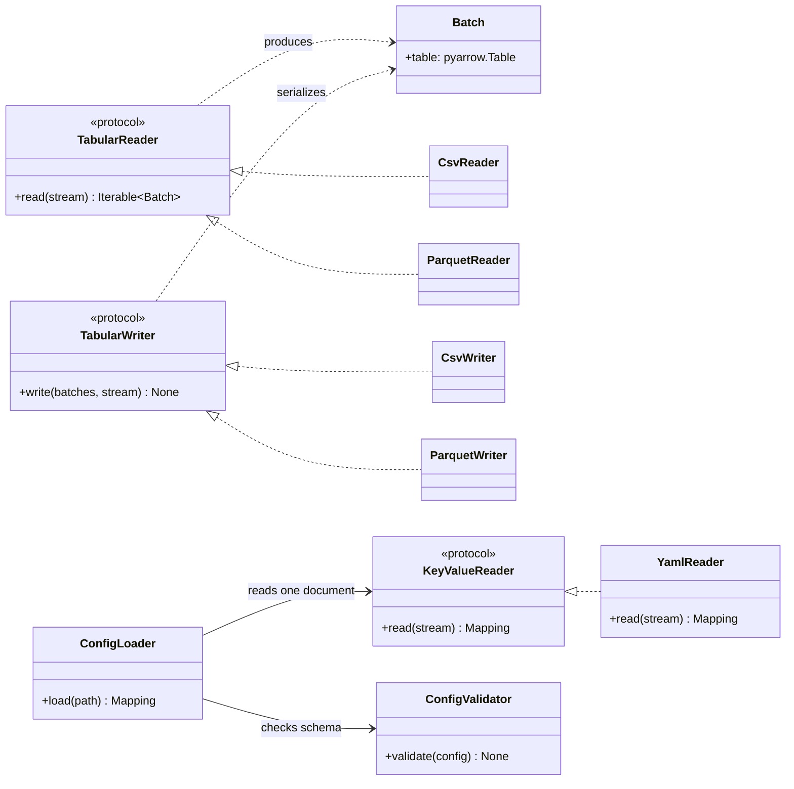

# Data Representation Contracts

## Status and scope

The tabular protocols are named `TabularReader` and `TabularWriter`. They read and write ETLRelay batches. `KeyValueReader` remains a separate protocol for reading mapping-shaped documents, with `YamlReader` as the existing implementation.

For v1.0, mapping-document writing and conversion between tabular batches and row records are deferred. Neither capability has a demonstrated requirement within the frozen feature set.

## Three distinct representations

### Tabular batches

ETLRelay uses `Batch` objects, backed by PyArrow tables, as the common in-memory tabular representation. The current `TabularReader` protocol reads a binary stream and returns an iterable of batches; `TabularWriter` serializes an iterable of batches to a binary stream.

```python
from collections.abc import Iterable
from typing import BinaryIO, Protocol

from etlrelay.core import Batch


class TabularReader(Protocol):
    def read(self, stream: BinaryIO) -> Iterable[Batch]:
        ...


class TabularWriter(Protocol):
    def write(self, batches: Iterable[Batch], stream: BinaryIO) -> None:
        ...
```

### Mapping-shaped documents

`KeyValueReader` reads one document mapping from a binary stream. `YamlReader` is the current implementation, using a safe loader and checking that the document root is a mapping with string keys. It rejects duplicate keys and multiple documents. It does not know the application schema.

```python
from collections.abc import Mapping
from typing import Any, BinaryIO, Protocol


class KeyValueReader(Protocol):
    def read(self, stream: BinaryIO) -> Mapping[str, Any]:
        ...
```

`ConfigLoader` depends on `KeyValueReader`, not directly on `YamlReader`. `ConfigValidator` then applies the ETLRelay versioned schema, while `PipelineBuilder` consumes the validated configuration and constructs runtime components. The YAML reader never produces `Batch` objects and is not part of the tabular format registry.

### Row records

A row record is an in-memory mapping such as `{"id": 1, "name": "Ada"}`. A sequence of such mappings is different from one configuration mapping and from an iterable of `Batch` objects. ETLRelay does not introduce a general conversion framework between these representations in the frozen v1.0 scope.

## Configuration loading boundary

```text
Config file
    │
    ▼
FileSystem.open_read(path)
    │
    ▼
Binary stream
    │
    ▼
KeyValueReader.read(stream)  ──> one root Mapping[str, Any]
    │
    ▼
ConfigValidator.validate(mapping)
    │
    ▼
Validated mapping
    │
    ▼
PipelineBuilder.build(mapping)  ──> Pipeline
```

The loader must not construct sources, processors, sinks, SQLAlchemy engines, or pipelines. The builder owns component construction and SQL environment preflight. Schema validation and preflight occur before configured source/sink I/O starts.

## Format registry boundaries

`TabularFileFormatRegistry` contains reader and writer factories for tabular formats such as CSV and Parquet. It models reading and writing independently, because a format can be read-only or write-only. The default catalog registers CSV and Parquet readers/writers.

`YamlReader` is not a tabular format reader. It implements `KeyValueReader` and does not belong in the tabular registry. A future `JsonReader` could satisfy the same document-reader contract without changing the configuration schema, but JSON support is not included in the frozen v1.0 scope.

## Tabular/record conversion — deferred

Tabular-to-records and records-to-tabular conversion are not required for v1.0. No conversion protocol or generic conversion framework is introduced.
Before revisiting this decision, define a concrete consumer, eager/lazy row
iteration, schema inference versus explicit schema, column order, missing/extra
fields, empty input, null and Arrow-specific values, batching, and cleanup.
Mapping-document parsing does not establish those row-conversion semantics.

## Protocol naming and mapping-document writing

`TabularReader` and `TabularWriter` explicitly identify the batch-oriented contracts. Concrete format implementations retain their existing names: `CsvReader`, `ParquetReader`, `CsvWriter`, and `ParquetWriter`.

`KeyValueReader` remains separate because one mapping-shaped document is a different representation from tabular batches or an iterable of row records.

`KeyValueWriter` is deferred beyond v1.0. Configuration loading requires document reading, and no mapping-document serialization use case currently justifies a writer protocol.

## Class diagram: tabular data versus mapping-shaped documents

The diagram below summarizes the principal types and dependencies described on this page. Existing flow, sequence, and data-flow diagrams remain part of this document.


