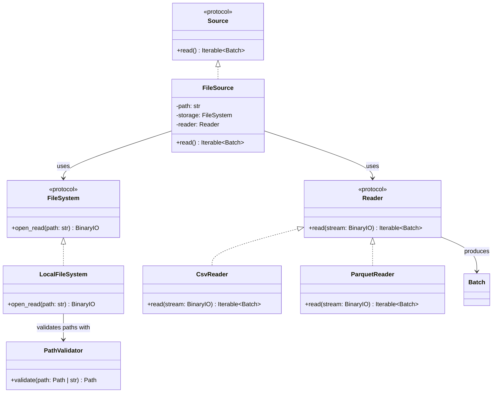

# FileSource

## Purpose

`FileSource` is a source component responsible for reading data from a configured file resource and producing ETLRelay `Batch` objects.

It composes two independent components:

* `FileSystem`, which provides access to the resource through a binary stream.
* `Reader`, which parses the resource and produces an iterable of `Batch` objects.

`FileSource` does not depend on a particular file format. The current implementation combines `LocalFileSystem` with `CsvReader` or `ParquetReader` without changing the source implementation.

## Class Diagram



## Responsibilities

### FileSource

`FileSource` is responsible for:

* Storing the configured resource path.
* Opening the resource through the supplied `FileSystem`.
* Passing the resulting binary stream to the supplied `Reader`.
* Exposing the reader's batches through the `Source` interface.
* Ensuring the opened stream remains available while batches are being read.
* Closing the stream when iteration finishes, fails, or is explicitly closed.

`FileSource` is **not** responsible for:

* Implementing filesystem operations.
* Validating local filesystem path containment.
* Parsing CSV, Parquet, or other file formats.
* Constructing `Batch` objects directly.
* Transforming data.
* Writing files.
* Orchestrating pipeline execution.

### FileSystem

`FileSystem` defines the contract for accessing file resources.

Its implementations open resources for reading and provide binary streams. Storage-specific behavior, such as local path validation, remains within the concrete storage implementation.

`FileSource` depends on the protocol rather than on `LocalFileSystem`.

### Reader

`Reader` defines the contract for parsing a binary stream and producing an iterable of ETLRelay `Batch` objects.

Its implementations handle format-specific parsing. The current built-in readers are `CsvReader` and `ParquetReader`.

A reader may produce one or more batches. `FileSource` does not need to know how the reader divides its output into batches or how it interprets the underlying format. Format-specific constraints remain the reader's responsibility; for example, the Parquet reader requires a seekable binary stream.

## Dependency Relationship

```text
Source
  ▲
  │ implements
  │
FileSource
  ├── FileSystem
  │      └── LocalFileSystem
  │              └── PathValidator
  │
  └── Reader
         ├── CsvReader
         └── ParquetReader
```

`FileSource` depends on the `FileSystem` and `Reader` protocols, not their concrete implementations.

Current file-based combinations use local storage with one of the built-in formats:

```text
LocalFileSystem + CsvReader
LocalFileSystem + ParquetReader
```

Remote storage backends such as S3 and HDFS are not implemented in v0.6.0 and are not part of the planned v1.0.0 scope. Additional storage implementations may be reviewed after v1.0.0 if concrete requirements justify them; no particular backend or release date is promised.

## Data Flow

The source coordinates the following operations:

```text
FileSource.read()
       │
       ▼
FileSystem.open_read(path)
       │
       ▼
  BinaryIO stream
       │
       ▼
Reader.read(stream)
       │
       ▼
Iterable[Batch]
       │
       ▼
Pipeline
```

The reader determines how many batches are produced. `FileSource` exposes those batches through the `Source` interface without performing additional format conversion or transformation.

The stream must remain open while the reader's iterable is consumed. This is particularly important when a reader produces batches lazily. The stream should be managed with a context manager so that it is closed reliably when iteration completes or terminates with an exception.

## Interface

```python
from collections.abc import Iterable

from etlrelay.core import Batch, Reader
from etlrelay.storage import FileSystem


class FileSource:
    def __init__(
        self,
        path: str,
        storage: FileSystem,
        reader: Reader,
    ) -> None:
        ...

    def read(self) -> Iterable[Batch]:
        ...
```

## Contract

| Operation | Expected behavior |
| --- | --- |
| Construct with path, storage, and reader | Stores the supplied dependencies and resource path |
| Read a valid resource | Produces an iterable of parsed batches |
| Read a nonexistent local file | Propagates the storage error |
| Read an invalid CSV or Parquet resource | Propagates the reader's parsing error |
| Read a resource outside the permitted local base | Propagates the path-validation error from local storage |
| Consume batches | Keeps the opened stream available while the reader's iterable is consumed |
| Finish or terminate iteration | Closes the opened stream |
| Supply another storage implementation | Works without modifying `FileSource`, provided it satisfies `FileSystem` and its behavioral contract |
| Supply another reader implementation | Works without modifying `FileSource`, provided it satisfies `Reader` and its behavioral contract |

Exceptions are propagated rather than wrapped in a new `FileSource` exception hierarchy.

When `FileSource.read()` is consumed directly, the caller must explicitly
close the returned generator if iteration stops early and deterministic
cleanup is required.

When the source is used by `Pipeline`, the pipeline closes the active
source iterator on termination. This includes early sink termination and
failures during processing or writing.

`FileSource` owns the stream it opens, but does not own the injected
`FileSystem` or `Reader` instances.

## SOLID Considerations

### Single Responsibility Principle

`FileSource` has one primary responsibility: coordinating storage access and format reading to produce batches for the pipeline.

It does not implement filesystem operations or format-specific parsing.

### Open/Closed Principle

New reader implementations can be introduced without modifying `FileSource`. New storage implementations could also satisfy the protocol, but none beyond `LocalFileSystem` is currently included in the supported project scope.

For example, adding a new reader for another supported local file format does not require changes to the source implementation.

No factory, registry, or plugin framework is required for this behavior.

### Liskov Substitution Principle

Any implementation satisfying `FileSystem` can be supplied as storage, and any implementation satisfying `Reader` can be supplied as a reader, provided it preserves the documented contracts, including binary-stream behavior, batch iteration, resource lifetime, and exception propagation.

### Interface Segregation Principle

`FileSource` depends on two small protocols:

* `FileSystem` provides resource access.
* `Reader` provides format parsing and batch production.

Neither protocol needs unrelated operations such as writing, transformation, or pipeline execution.

### Dependency Inversion Principle

`FileSource` depends on protocols rather than concrete storage and reader classes.

This keeps source orchestration independent of local filesystem details and specific file formats.

## Design Constraints

The implementation should remain small:

* Accept a resource path, `FileSystem`, and `Reader`.
* Use `FileSystem.open_read()` to obtain the stream.
* Pass the stream to `Reader.read()`.
* Expose the resulting batches through the `Source` interface.
* Keep the stream open for the duration of iteration.
* Close the stream reliably, including when iteration fails.
* Propagate underlying exceptions.
* Avoid format detection, factories, registries, retries, and additional chunking abstractions until concrete requirements justify them.

The central design principle is:

**`FileSource` coordinates resource access and batch production; the storage implementation handles the resource, and the reader handles the format.**
