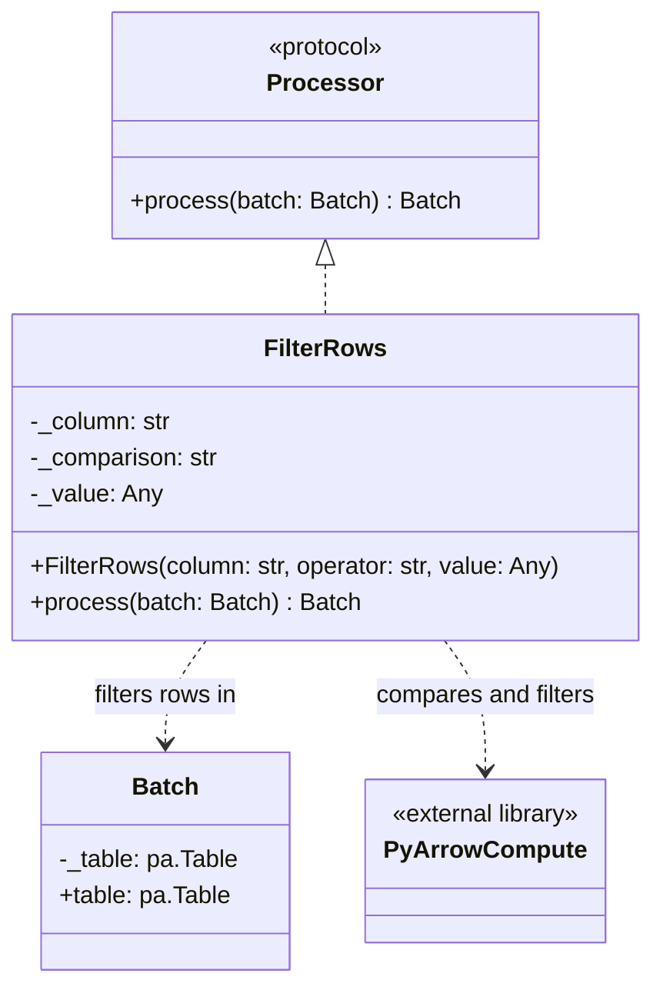

# FilterRows Processor

## Purpose

`FilterRows` is a built-in implementation of the `Processor` contract. It filters a `Batch` using one comparison between a named column and a configured value. Comparisons and row filtering use Apache Arrow compute operations.

The processor provides a deliberately small predicate interface; it does not implement an expression language or custom casting system.

## Class diagram

## Responsibilities and behavior

`FilterRows` stores one column name, one supported comparison operator, and one comparison value. It returns a new `Batch` containing rows that satisfy the predicate.

Supported operators are `==`, `!=`, `<`, `<=`, `>`, and `>=`.

| Scenario | Behavior |
|---|---|
| Unsupported operator | Raises `ValueError` during initialization. |
| Unknown or ambiguous column | Raises `ValueError` when processing a batch. |
| Incompatible comparison types | Raises `TypeError`; no custom casting is performed. |
| Comparison evaluates to null | Excludes the row. |
| No rows match | Returns a zero-row batch with the original schema. |
| Input has zero rows | Returns a zero-row batch with the original schema. |
| All rows match | Retains all rows and the original schema. |
| Processor reused for another batch | Processes that batch independently; input-batch state is not retained. |

`FilterRows` does not alter the input schema, select or rename columns, perform I/O, or coordinate pipeline execution. Cross-batch output-schema compatibility is enforced by `Pipeline`, not by an individual processor.

See [Core Concepts](../concepts.md) for the batch model and [API Reference](../api-reference.md) for constructor details.
