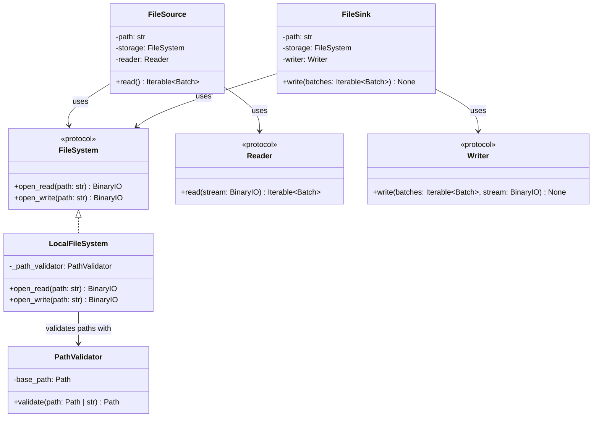

# FileSystem

## Purpose

`FileSystem` is a protocol defining the storage-access contract used by ETLRelay's file sources and sinks.

`LocalFileSystem` implements this protocol by providing readable and writable binary streams for local filesystem paths.

Storage access is separated from file-format handling. `LocalFileSystem` does not know about CSV, Parquet, `Batch`, readers, writers, sources, sinks, or pipeline orchestration.

For local filesystem security, `LocalFileSystem` uses `PathValidator` to ensure that paths resolve within the configured permitted directory.

## Class Diagram



## Responsibilities

### FileSystem

`FileSystem` defines the minimal storage contract required by file sources and sinks.

It is responsible for exposing operations that open resources as binary streams:

* `open_read()` opens a resource for reading.
* `open_write()` opens a resource for writing.

`FileSystem` is **not** responsible for:

* Parsing or serializing file formats.
* Creating or interpreting `Batch` objects.
* Implementing source or sink orchestration.
* Pipeline execution.
* Application-level logging.

The protocol is intentionally small so that multiple storage implementations can satisfy the same contract.

### LocalFileSystem

`LocalFileSystem` is responsible for:

* Opening local files for binary reading.
* Opening local files for binary writing.
* Validating path containment through `PathValidator`.
* Translating a `FileNotFoundError` raised while opening an input file into `FileSystemError`, including when the file disappears after path validation.
* Returning binary streams to callers.
* Propagating filesystem access errors.

`LocalFileSystem` is **not** responsible for:

* Parsing CSV, Parquet, or other formats.
* Serializing `Batch` objects.
* Selecting readers or writers.
* Creating missing parent directories.
* Source or sink orchestration.
* Pipeline execution.
* Application-level logging.

The storage implementation handles filesystem existence and I/O behavior. `PathValidator` handles path containment.

### PathValidator

`PathValidator` determines whether a candidate path resolves within its configured base directory.

It accepts paths represented as `Path` objects or strings and returns the resolved path when the containment check succeeds.

It does not check whether the path exists.

This separation supports both input and output paths:

```text
FileSource
    │
    └── Existing input path
            │
            ▼
       LocalFileSystem
            │
            ▼
         open_read()
```

```text
FileSink
    │
    └── Existing or new output path
            │
            ▼
       LocalFileSystem
            │
            ▼
         open_write()
```

## Dependency Relationship

`FileSource` and `FileSink` depend on the `FileSystem` protocol rather than directly on `LocalFileSystem`.

```text
FileSource ──┐
             ├──> FileSystem
FileSink ────┘
                  ▲
                  │ implements
                  │
             LocalFileSystem
                  │
                  ▼
             PathValidator
```


The current storage implementation is `LocalFileSystem`. S3, HDFS, and
other remote-storage backends are not included in v0.4.0 or the planned
v1.0.0 scope.

The `FileSystem` protocol establishes a small storage-access boundary, but
it does not mean that remote backends are implemented or committed for a
future release. Additional storage and platform integrations may be
reviewed after v1.0.0 if concrete requirements justify them. No particular
backend or release date is promised.


## Data Flow

### FileSource

```text
FileSource
    │
    ├── FileSystem.open_read(path)
    │          │
    │          ▼
    │       BinaryIO
    │          │
    │          ▼
    └────── Reader.read(stream)
                   │
                   ▼
             Iterable[Batch]
```

The storage component opens the resource, and the reader interprets its contents. The reader may produce multiple batches from one resource.

### FileSink

```text
FileSink
    │
    ├── FileSystem.open_write(path)
    │          │
    │          ▼
    │       BinaryIO
    │          │
    │          ▼
    └────── Writer.write(batches, stream)
                   │
                   ▼
              Serialized data
```

The writer serializes the supplied batches into the output stream. The storage component determines where the stream is stored.


`FileSource` and `FileSink` manage the streams they open.

`FileSource.read()` performs file access lazily, as its returned generator is
consumed. The input stream is closed when iteration completes, reading
raises an exception, or the generator is explicitly closed. Consumers that
stop iterating early should explicitly close the generator when deterministic
cleanup is required.

`FileSink` closes the output stream after writing succeeds or fails.
Exceptions raised by the reader or writer propagate to the caller without
being converted into generic source or sink exceptions.

Opening an output uses truncating write mode. If a writer fails, a partial
or empty output file may remain; an existing destination may already have
been truncated. The storage contract does not guarantee rollback or atomic
replacement.


## Interface

### FileSystem

```python
from typing import BinaryIO, Protocol


class FileSystem(Protocol):
    def open_read(self, path: str) -> BinaryIO:
        ...

    def open_write(self, path: str) -> BinaryIO:
        ...
```

### LocalFileSystem

```python
from typing import BinaryIO

from etlrelay.security import PathValidator


class LocalFileSystem:
    def __init__(self, path_validator: PathValidator) -> None:
        self._path_validator = path_validator

    def open_read(self, path: str) -> BinaryIO:
        ...

    def open_write(self, path: str) -> BinaryIO:
        ...
```

## Contract

| Operation | Expected behavior |
| --- | --- |
| `open_read(path)` | Validates path containment and opens the file in binary read mode (`rb`). It does not perform a separate existence check before opening. |
| `open_write(path)` | Validates path containment and opens the file in binary write mode (`wb`). |
| Open a nonexistent input file | Translates `FileNotFoundError` from the open operation into `FileSystemError`. |
| Open a new output with an existing parent directory | Creates the destination file. |
| Open an existing output | Truncates its existing contents when the file is opened. |
| Open an output whose parent directory is missing | Propagates `FileNotFoundError`; parent directories are not created automatically. |
| Access a path outside the permitted base | Raises `PathValidationError`. |
| Encounter another filesystem failure | Propagates the original filesystem exception. |

The behavior above describes `LocalFileSystem`. The `FileSystem` protocol
defines the stream-opening interface; implementations must document and
satisfy the behavioral contract expected by their consumers.

Both operations return binary streams owned by the caller. Direct callers
must close returned streams. When the streams are used through `FileSource`
or `FileSink`, those components manage their respective stream lifetimes.

`PathValidator` is responsible for path containment, not existence or
access-permission checks. Filesystem operations determine whether a
resource can be opened.

## SOLID Considerations

### Single Responsibility Principle

`LocalFileSystem` has one primary responsibility: providing local filesystem access.

Path containment is delegated to `PathValidator`, while parsing and serialization are delegated to readers and writers.

### Open/Closed Principle

Additional storage implementations can satisfy `FileSystem` without requiring modifications to `FileSource` or `FileSink`.

The current implementation does not require a storage factory, registry, or plugin mechanism.

### Liskov Substitution Principle

Any implementation satisfying `FileSystem` can be supplied to a file source or sink, provided it preserves the protocol's behavioral contract.

Implementations must return usable binary streams and document their storage-specific behavior consistently.

### Interface Segregation Principle

`FileSystem` exposes only two operations:

* Opening a resource for reading.
* Opening a resource for writing.

It does not expose unrelated filesystem administration operations such as directory traversal, permissions management, metadata management, or deletion.

### Dependency Inversion Principle

`FileSource` and `FileSink` depend on `FileSystem`, not on `LocalFileSystem`.

`LocalFileSystem` depends on `PathValidator` to enforce local path containment.

This keeps the higher-level components independent of local filesystem details.

## Design Constraints

The storage protocol operates on binary streams rather than requiring callers to read or write an entire resource as `bytes`.

This allows readers and writers to operate on streams without requiring the storage component to load the entire serialized resource into memory first.

Readers and writers operate on binary streams, so they do not need to know
where the data is stored. The current implementation provides local
filesystem access through `LocalFileSystem`. Additional implementations
would require their own implementation and contract tests; none is included
in the v0.4.0 milestone or planned v1.0.0 scope.

`LocalFileSystem` should continue using Python's standard filesystem APIs and `pathlib.Path` internally.

`PathValidator` remains responsible for local path containment. `LocalFileSystem` remains responsible for existence checks and filesystem operations.

No additional abstractions such as storage factories, registries, remote filesystem base classes, or generic resource managers are required at this stage.
