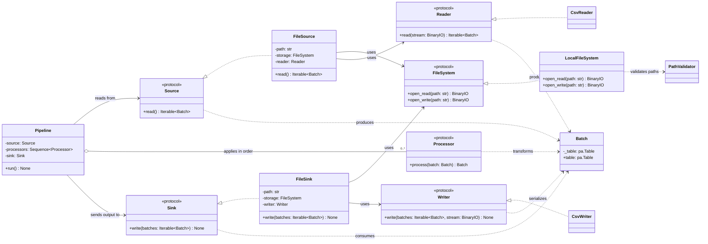

# ETLRelay Architecture Overview

## Purpose

ETLRelay is organized around a small set of composable contracts. `Pipeline` coordinates batch processing; sources obtain data, processors transform batches, and sinks consume the processed output. File-based sources and sinks compose a filesystem implementation with a format-specific reader or writer.

This overview shows how the main components relate. The linked architecture pages describe each boundary in more detail.

## Class diagram

## Component responsibilities

| Component | Responsibility |
|---|---|
| `Batch` | Wraps the Apache Arrow table used as the pipeline's common tabular representation. |
| `Source` | Produces an iterable of batches. |
| `Processor` | Transforms one batch and returns one batch through `process(batch: Batch) -> Batch`. |
| `Sink` | Consumes an iterable of processed batches. |
| `Pipeline` | Applies processors in order and validates the schema of processed output batches during a run. |
| `FileSource` / `FileSink` | Compose storage access with reading or writing. |
| `FileSystem` | Opens readable or writable binary streams. |
| `Reader` / `Writer` | Convert between a stream format and the common batch representation. |
| `LocalFileSystem`, `CsvReader`, `CsvWriter` | Provide the current local-filesystem and CSV implementations. |

The diagram shows the current local CSV composition, not an exhaustive list of every possible implementation. The built-in processors are documented in [SelectColumns and RenameColumns](select_columns_and_rename_columns.md), [FilterRows](filter_rows_processor.md), and the API Reference.

## SQL source and sink

`SqlSource` and `SqlSink` implement the core source/sink contracts directly. They do not pass through `FileSystem`, `Reader`, or `Writer`. `SqlSource` executes parameterized SQLAlchemy text queries and produces a batch for non-empty results; `SqlSink` appends rows to a pre-existing table with a separate transaction per non-empty batch. See [SQL source and sink](sql_source_and_sink.md) for the full behavior and limitations.

## Batch and empty-data distinction

A `Batch` is a single data unit backed by an Arrow table. A zero-row table is still a batch and retains its schema. An empty source iterable contains no batches; in that case the pipeline does not invoke processors or the sink. See [Pipeline](pipeline.md) for the full execution and schema-validation contract.

## Related architecture pages

- [Pipeline](pipeline.md) — execution order, output-schema validation, empty-data behavior, and exception propagation.
- [SQL source and sink](sql_source_and_sink.md) — database query behavior, table requirements, engine ownership, and transaction scope.
- [File source](file_source.md) and [File sink](file_sink.md) — composition of filesystem and format components.
- [Reader and writer](reader_and_writer.md) — format boundaries.
- [Local filesystem](local_filesystem.md) and [Path validator](path_validator.md) — local path access and containment.
- [SelectColumns and RenameColumns](select_columns_and_rename_columns.md) and [FilterRows](filter_rows_processor.md) — built-in processor implementations.
