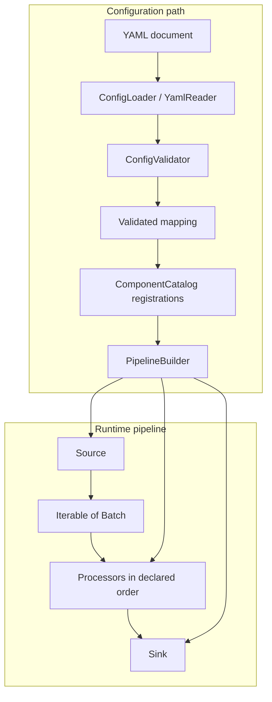
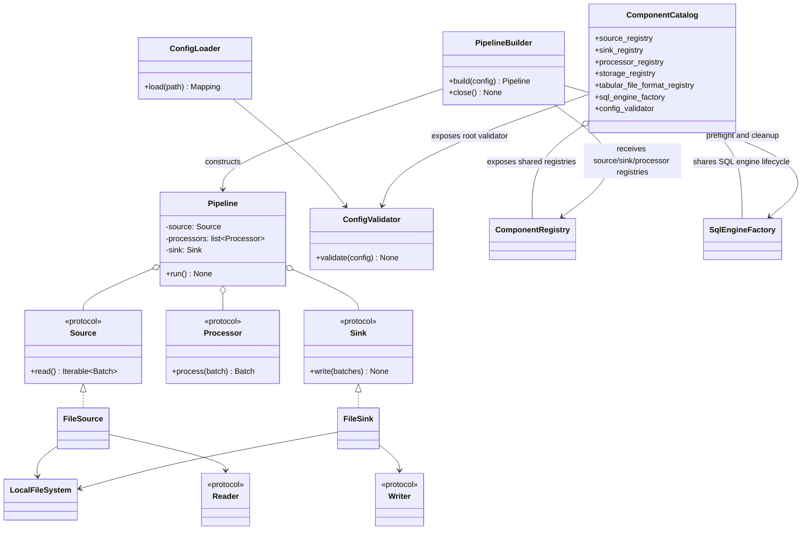

# ETLRelay Architecture Overview

## Purpose

ETLRelay is organized around composable runtime contracts and a separate configuration-construction layer. `Pipeline` coordinates batch processing; sources obtain data, processors transform batches, and sinks consume the processed output. File sources and sinks compose filesystem access with format-specific readers and writers.

ETLRelay 0.6.0 also permits users to declare supported pipelines in YAML. Configuration parsing, schema validation, component registration lookup, pipeline construction, and execution remain separate responsibilities.

## Runtime and configuration diagrams



The configuration loader and validator do not construct runtime components. `PipelineBuilder` resolves all component registrations and preflights SQL environment references before it invokes component factories. It returns a `Pipeline`; the caller separately executes `pipeline.run()`.

## Component responsibilities

| Component | Responsibility |
|---|---|
| `Batch` | Wraps the Arrow table used as the pipeline's common tabular representation. |
| `Source` | Produces an iterable of batches. |
| `Processor` | Transforms one batch through `process(batch: Batch) -> Batch`. |
| `Sink` | Consumes an iterable of processed batches. |
| `Pipeline` | Applies processors in order and validates processed output schemas during a run. |
| `FileSource` / `FileSink` | Compose storage access with reading or writing. |
| `FileSystem` | Opens readable or writable binary streams. |
| `Reader` / `Writer` | Convert between serialized tabular formats and batches. |
| `KeyValueReader` / `YamlReader` | Parse one mapping-shaped configuration document; does not produce batches. |
| `ConfigLoader` | Coordinates configuration-file reading, parsing, and validation. |
| `ConfigValidator` | Validates version 1 of the YAML configuration schema. |
| `ComponentRegistry` | Maps explicitly supported component names to validator/factory registrations. |
| `ComponentCatalog` | Shares default registries, validators, factories, and SQL engine service. |
| `PipelineBuilder` | Resolves registrations, preflights SQL environment variables, and builds a runtime pipeline. |

## File runtime path

```text
FileSystem.open_read(path)
          │
          ▼
      BinaryIO stream
          │
          ▼
       Reader.read(stream)
          │
          ▼
        Iterable[Batch]
```

The write path operates in the reverse direction. `LocalFileSystem` and `PathValidator` handle local resource access and path containment. CSV and Parquet formats are registered separately with independent reader/writer capabilities.

## Configuration path

`ConfigLoader` accepts a `FileSystem`, `KeyValueReader`, and `ConfigValidator`. Its `load(path)` method opens and parses the configuration document, closes the stream, validates the mapping, and returns that mapping. YAML syntax/root-shape failures, filesystem errors, and schema validation errors keep their distinct error boundaries.

`ConfigValidator` checks the root schema and delegates to source, processor-sequence, and sink validators. Dispatchers look up explicit `ComponentRegistration` instances and delegate to their configuration validators; factories are not called during validation.

`create_default_component_catalog()` wires a shared tabular-format registry, storage/source/sink/processor registries, dispatchers, root validator, and SQL engine factory. `PipelineBuilder` uses the same registries. This is an explicit composition root for a fixed built-in component set, not a dynamic plugin system.

## SQL ownership

Direct Python `SqlSource` and `SqlSink` components borrow the SQLAlchemy engine supplied by the caller. Configuration-built pipelines share the catalog's `SqlEngineFactory`, which resolves environment-variable references before engine creation and caches engines on demand. The caller must close the `PipelineBuilder` after execution so the factory disposes of the engines it owns.

## Related architecture pages

- [Pipeline](pipeline.md) — execution order, schema compatibility, empty data, and exception propagation.
- [File source](file_source.md) and [File sink](file_sink.md) — storage and format composition.
- [Reader and writer contracts](reader_and_writer.md) — tabular and mapping-shaped input boundaries.
- [Configuration loading](configuration-loading.md), [validation](configuration-validation.md), and [component registry](component-registry.md).
- [Local filesystem](local_filesystem.md) and [Path validator](path_validator.md).
- [SQL source and sink](sql_source_and_sink.md).

## Class diagram: runtime pipeline and configuration composition

The diagram below summarizes the principal types and dependencies described on this page. Existing flow, sequence, and data-flow diagrams remain part of this document.


