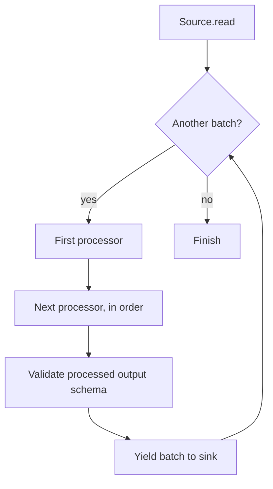
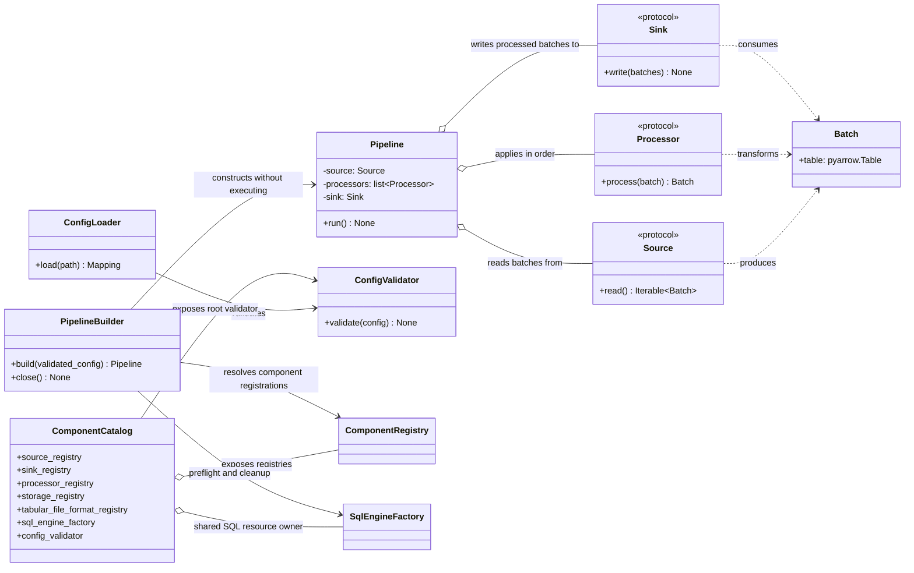

# Pipeline

## Purpose

`Pipeline` coordinates a source, an ordered sequence of processors, and a sink. It executes synchronously, processes batches in source order, applies processors in their configured order, and passes processed output to the sink.

## Execution flow

The pipeline does not buffer all source batches before writing. A failure while reading, processing, validating, or writing propagates to the caller. Previously written batches are not automatically rolled back.

## Output schema compatibility

The first processed output batch establishes the expected output schema. Each subsequent processed batch must match its field names, field order, Arrow data types, and nullability. Schema metadata differences are ignored. Validation occurs after all processors have run, so processors can normalize input batches before the compatibility check.

An incompatible output batch causes `ValueError` before that batch is passed to the sink. The pipeline does not automatically merge schemas, cast values, or reconcile incompatible outputs.

## Empty data

A zero-row `Batch` retains its schema and is processed normally. It participates in output schema validation and is delivered to the sink if processing succeeds.

An empty source iterable has no batches: processors are not invoked and the sink is not invoked. This is distinct from one zero-row batch.

## Direct construction and YAML construction

The pipeline contract is the same whether constructed directly in Python or from YAML. YAML does not change the execution semantics of `Pipeline`; it changes how the runtime components are selected and composed.

For a YAML configuration, the application flow is:

1. Load and validate the document with `ConfigLoader` and `ConfigValidator`.
2. Call `PipelineBuilder.build(validated_config)` to resolve registered components, preflight SQL environment-variable references, and construct the runtime objects.
3. Call `pipeline.run()` to execute the pipeline.
4. Call `builder.close()` after execution to release SQLAlchemy engines owned by the shared `SqlEngineFactory`.

`PipelineBuilder.build()` does not call `run()`. The caller controls execution and resource cleanup. Direct Python SQL components retain their original engine ownership contract; they do not take ownership of the engine passed to their constructors.

## Error boundaries

Configuration-schema errors are raised by `ConfigValidator` as `ConfigurationError`. Component type/preflight/construction errors from `PipelineBuilder` use `PipelineBuildError` for builder-level failures, while exceptions from runtime sources, processors, and sinks propagate according to their component contracts. The builder does not wrap all pipeline execution errors.

See [YAML Configuration](../configuration.md), [Configuration Loading Architecture](configuration-loading.md), and [Core Concepts](../concepts.md).

## Class diagram: pipeline composition and execution contracts

The diagram below summarizes the principal types and dependencies described on this page. Existing flow, sequence, and data-flow diagrams remain part of this document.

