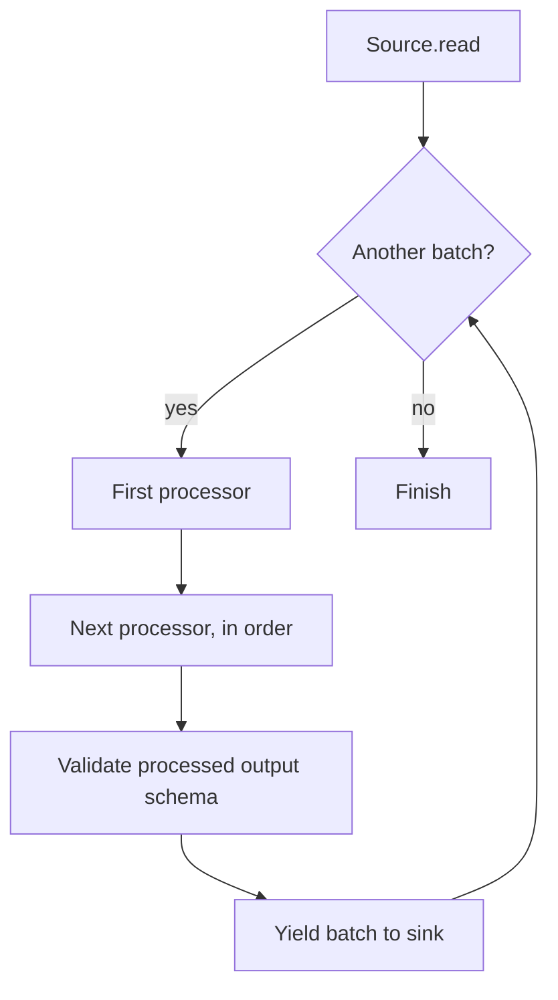

# Pipeline

## Purpose

`Pipeline` coordinates a source, an ordered sequence of processors, and a sink. It executes synchronously, processes batches in source order, applies processors in their configured order, and passes processed output to the sink.

## Execution flow

The pipeline does not buffer all source batches before writing. A failure while reading, processing, validating, or writing propagates to the caller. Previously written batches are not automatically rolled back.

## Output schema compatibility

The first processed output batch establishes the expected output schema. Each subsequent processed batch must match its field names, field order, Arrow data types, and nullability. Schema metadata differences are ignored. Validation occurs after all processors have run, so processors can normalize input batches before the compatibility check.

An incompatible output batch causes `ValueError` before that batch is passed to the sink. The pipeline does not automatically merge schemas, cast values, or reconcile incompatible outputs.

## Empty data

A zero-row `Batch` retains its schema and is processed normally. It participates in output schema validation and is delivered to the sink if processing succeeds.

An empty source iterable has no batches: processors are not invoked and the sink is not invoked. This is distinct from one zero-row batch.

## Direct construction and YAML construction

The pipeline contract is the same whether constructed directly in Python or from YAML. YAML does not change the execution semantics of `Pipeline`; it changes how the runtime components are selected and composed.

For a YAML configuration, the application flow is:

1. Load and validate the document with `ConfigLoader` and `ConfigValidator`.
2. Call `PipelineBuilder.build(validated_config)` to resolve registered components, preflight SQL environment-variable references, and construct the runtime objects.
3. Call `pipeline.run()` to execute the pipeline.
4. Call `builder.close()` after execution to release SQLAlchemy engines owned by the shared `SqlEngineFactory`.

`PipelineBuilder.build()` does not call `run()`. The caller controls execution and resource cleanup. Direct Python SQL components retain their original engine ownership contract; they do not take ownership of the engine passed to their constructors.

## Error boundaries

Configuration-schema errors are raised by `ConfigValidator` as `ConfigurationError`. Component type/preflight/construction errors from `PipelineBuilder` use `PipelineBuildError` for builder-level failures, while exceptions from runtime sources, processors, and sinks propagate according to their component contracts. The builder does not wrap all pipeline execution errors.

See [YAML Configuration](../configuration.md), [Configuration Loading Architecture](configuration-loading.md), and [Core Concepts](../concepts.md).

## Resource lifecycle and failure semantics

`Pipeline` coordinates execution and consumes batches lazily. It does not own the underlying storage backends, database engines, readers, writers, or component instances.

### Source iterator cleanup

During `Pipeline.run()`, ETLRelay consumes the iterable returned by `Source.read()` and passes processed batches to the configured sink.

When execution terminates, the pipeline attempts to close its processing iterator and the underlying source iterator if they expose callable `close()` methods.

Cleanup occurs when:

- The sink consumes all batches successfully.
- The source produces no batches.
- The sink returns without consuming every batch.
- The source or a processor raises an exception.
- The sink raises an exception.
- A later batch fails schema validation.

Closing an iterator allows a lazy source such as `FileSource` to release a stream that is still open because iteration stopped early.

The `Source` protocol returns `Iterable[Batch]` and does not require every iterable to support `close()`. The pipeline only invokes that method when available.

Direct consumers of `FileSource.read()` must explicitly close the generator when they stop iteration early and require deterministic resource cleanup.

### Failure and cleanup precedence

Exceptions from sources, processors, and sinks propagate to the caller.

If execution fails and iterator cleanup also fails, the execution error takes precedence. Secondary cleanup failures are reported through safe operational warnings.

If execution succeeds but iterator cleanup fails, the first cleanup exception propagates after cleanup has been attempted for the remaining iterators.

The pipeline does not log successful completion when required cleanup fails.

### Empty sources and zero-row batches

A source producing **no batches** causes the pipeline to finish without invoking the sink. No destination is opened by the sink in this case, and an existing output file is not truncated.

A source producing a **zero-row batch** is different. That batch is processed, schema-validated, and passed to the sink.

The first processed batch establishes the expected schema even when it contains no rows.

The concrete sink or writer determines what is persisted for a zero-row batch.

### Schema compatibility

Every processed output batch must match the schema established by the first processed output batch.

Compatibility requires matching:

- Field names and order.
- Arrow field types.
- Field nullability.

Schema metadata differences are ignored.

This validation includes zero-row batches. A later incompatible batch raises `ValueError` before being delivered to the sink.

The pipeline does not attempt automatic type casting, field reordering, or schema reconciliation.

### Partial writes and rollback

The pipeline does not provide atomic execution or transaction rollback across an entire run.

A failure can occur after one or more earlier batches have already been written.

The resulting persistence behavior depends on the sink:

- **File sinks:** Output streams close on completion or failure, but an empty or partially written destination may remain. Existing files may already have been truncated.
- **SQL sinks:** Each nonempty batch uses its own transaction. The failed transaction is rolled back, while earlier successfully committed batches remain committed.

The pipeline does not retry failed operations or automatically restore previous output.

Applications requiring atomic replacement, pipeline-wide transactions, or idempotent retries must implement those guarantees outside the current ETLRelay contracts.

## Class diagram: pipeline composition and execution contracts

The diagram below summarizes the principal types and dependencies described on this page. Existing flow, sequence, and data-flow diagrams remain part of this document.

