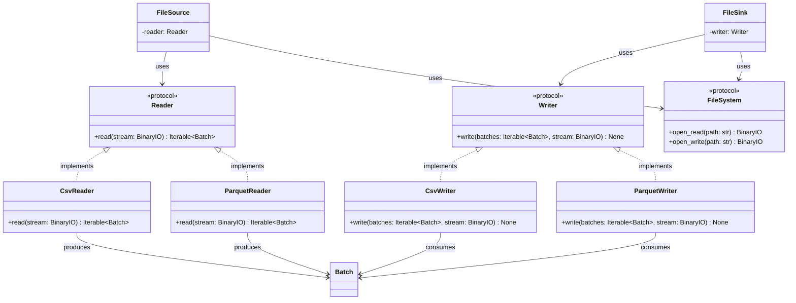

# Reader and Writer

## Purpose

`Reader` and `Writer` define small protocols for converting between serialized data and ETLRelay's common `Batch` representation.

A `Reader` consumes a binary stream and produces an iterable of `Batch` objects.

A `Writer` consumes an iterable of `Batch` objects and serializes them to a binary stream.

The protocols separate format-specific parsing and serialization from storage access. Higher-level components such as `FileSource` and `FileSink` compose these protocols with a `FileSystem` implementation.

The concrete implementations are `CsvReader`, `CsvWriter`, `ParquetReader`, and `ParquetWriter`.

## Class Diagram



## Responsibilities

### Reader

`Reader` defines the contract for converting serialized data from a binary stream into ETLRelay batches.

It is responsible only for defining the reading operation and its return contract.

`Reader` is **not** responsible for:

* Opening filesystem resources.
* Selecting storage backends or resource paths.
* Validating local filesystem path containment.
* Writing serialized data.
* Transforming batches as part of pipeline processing.
* Orchestrating pipelines.

### Writer

`Writer` defines the contract for serializing ETLRelay batches to a binary stream.

It is responsible only for defining the writing operation and its input contract.

`Writer` is **not** responsible for:

* Opening filesystem resources.
* Selecting storage backends or destination paths.
* Validating local filesystem path containment.
* Reading serialized data.
* Applying pipeline transformations.
* Orchestrating pipelines.

### CsvReader

`CsvReader` implements `Reader` for CSV data.

It is responsible for:

* Parsing CSV data from a supplied binary stream.
* Converting parsed data into ETLRelay `Batch` objects.
* Returning the resulting batches through an iterable.

It is **not** responsible for:

* Opening or locating files.
* Validating filesystem paths.
* Writing CSV data.
* Applying pipeline transformations.
* Managing pipeline execution.

The underlying parsing implementation uses PyArrow.

### CsvWriter

`CsvWriter` implements `Writer` for CSV data.

It is responsible for:

* Accepting an iterable of `Batch` objects.
* Serializing the batches as CSV data.
* Writing the serialized output to the supplied binary stream.

It is **not** responsible for:

* Opening or locating the destination.
* Validating filesystem paths.
* Reading CSV data.
* Applying pipeline transformations.
* Managing pipeline execution.

The underlying serialization implementation uses PyArrow.

### ParquetReader

`ParquetReader` implements `Reader` for Parquet files. It uses PyArrow's Parquet file API to read a binary stream and yield ETLRelay `Batch` objects. It preserves the schema and supported Arrow types represented in the file, including null values for the supported types exercised by the tests. A zero-row Parquet file produces one zero-row batch with its schema, so an empty dataset remains distinguishable from a source that yields no batches.

The input stream must be seekable because PyArrow's Parquet API needs to access file metadata and column data through a seekable file-like object. The generic `BinaryIO` protocol does not express this requirement. The caller retains responsibility for opening and closing the stream. Malformed Parquet content raises `pyarrow.ArrowInvalid`; I/O errors may propagate as `OSError`.

### ParquetWriter

`ParquetWriter` implements `Writer` for Parquet data. It serializes all supplied batches into one Parquet file through PyArrow. The first batch establishes the output schema, and later batches must have a matching schema; ETLRelay does not merge schemas or cast incompatible batches automatically. A zero-row batch is valid because it still supplies a schema and creates a valid zero-row Parquet file.

An empty batch iterable raises `WriterError`: without a batch, the writer has no schema with which to initialize the Parquet file. This differs from an iterable containing one zero-row batch. The writer finalizes the Parquet container but does not take ownership of the caller's underlying stream.

## Dependency Relationship

```text
FileSource ──> Reader
                  ▲
                  │
              CsvReader

FileSink ───> Writer
                  ▲
                  │
              CsvWriter
```

`FileSource` depends on the `Reader` protocol rather than directly on `CsvReader`.

`FileSink` depends on the `Writer` protocol rather than directly on `CsvWriter`.

Storage access is a separate dependency:

```text
FileSource ──> FileSystem
FileSink   ──> FileSystem
```

The `FileSystem` implementation opens the resource and provides a binary stream. The reader or writer then operates on that stream without needing to know where the data is stored.

This separation allows different storage implementations and format implementations to be combined without modifying the source or sink orchestration.

For example:

```python
FileSource(
    path="input.csv",
    storage=LocalFileSystem(...),
    reader=CsvReader(),
)
```

For Parquet, supply `ParquetReader()` instead. The corresponding sink accepts `ParquetWriter()`. Format selection is explicit at composition time; `FileSource` and `FileSink` do not inspect extensions or select a format automatically.

## Interfaces

### Reader

```python
from collections.abc import Iterable
from typing import BinaryIO, Protocol

from etlrelay.core import Batch


class Reader(Protocol):
    def read(self, stream: BinaryIO) -> Iterable[Batch]:
        ...
```

### Writer

```python
from collections.abc import Iterable
from typing import BinaryIO, Protocol

from etlrelay.core import Batch


class Writer(Protocol):
    def write(
        self,
        batches: Iterable[Batch],
        stream: BinaryIO,
    ) -> None:
        ...
```

### CsvReader

```python
class CsvReader:
    def read(self, stream: BinaryIO) -> Iterable[Batch]:
        ...
```

### CsvWriter

```python
class CsvWriter:
    def write(
        self,
        batches: Iterable[Batch],
        stream: BinaryIO,
    ) -> None:
        ...
```

### ParquetReader

```python
class ParquetReader:
    def read(self, stream: BinaryIO) -> Iterable[Batch]:
        ...
```

### ParquetWriter

```python
class ParquetWriter:
    def write(
        self,
        batches: Iterable[Batch],
        stream: BinaryIO,
    ) -> None:
        ...
```

## Contract

### Reader

| Operation                   | Expected behavior                                 |
| --------------------------- | ------------------------------------------------- |
| Read valid CSV data         | Returns an iterable of `Batch` objects            |
| Read malformed CSV data     | Raises an appropriate parsing exception           |
| Read from a supplied stream | Parses the supplied stream without opening a path |
| Implement another format    | Can provide another implementation of `Reader`    |

### Writer

| Operation                    | Expected behavior                                                 |
| ---------------------------- | ----------------------------------------------------------------- |
| Write an iterable of batches | Serializes the supplied batches to the stream                     |
| Write multiple batches       | Preserves batch order and serializes their data                   |
| Write an empty batch         | Handles it according to the writer's defined empty-batch behavior |
| Write an empty iterable      | Handles the absence of batches according to the writer's contract |
| Implement another format     | Can provide another implementation of `Writer`                    |

Readers and writers do not validate filesystem paths. Storage access and local path containment are handled by the storage implementation and its security dependencies.

The reader/writer receive the stream from their caller and do not close it. Stream ownership remains with the component that opened it, typically `FileSource` or `FileSink` using a context manager.

## CSV and Parquet Behavior

The file format is selected when composing the source or sink. `FileSource` and `FileSink` do not inspect the filename extension or choose a reader/writer automatically.

| Behavior | CSV | Parquet |
| --- | --- | --- |
| Representation | Text; no embedded Arrow schema | Columnar binary format with schema and type information |
| Reading types | PyArrow infers types from text; exact schema round trips are not guaranteed | Preserves schema and supported Arrow types represented in the Parquet file |
| Multiple batches | Serializes batches in order; a CSV stream has one header written by the first batch | Serializes batches in order into one Parquet file |
| Zero-row batch with schema | Can write a header-only CSV | Writes a valid schema-bearing zero-row Parquet file; the reader yields one empty batch with the schema |
| Empty batch iterable | Writes no bytes | Raises `WriterError` because no schema is available to initialize the file |
| Stream requirements | Binary stream | Reader: seekable binary stream; writer: writable binary stream supported by PyArrow |

A zero-row batch and an empty batch iterable are different: the former still carries an Arrow schema; the latter carries no batch from which a schema can be obtained. `ParquetWriter` uses the first batch's schema and requires following batches to have the same schema. ETLRelay does not merge incompatible schemas or automatically cast batches.

Parquet preserves supported Arrow schema/type information and values for the types handled by the installed PyArrow version; this should not be read as a guarantee that every Arrow-specific type, extension type, or metadata field is losslessly represented by Parquet. The stream protocols use `BinaryIO`, which does not express seekability in its type signature. `ParquetReader` therefore has a stronger runtime requirement than the generic `Reader` protocol suggests. The caller/component that opens a stream retains responsibility for its lifecycle; readers and writers must not close caller-owned streams.

## SOLID Considerations

### Single Responsibility Principle

Each component has one primary reason to change:

* `Reader` changes if the reading contract changes.
* `Writer` changes if the writing contract changes.
* `CsvReader` changes if CSV parsing behavior changes.
* `CsvWriter` changes if CSV serialization behavior changes.

Format-specific parsing and serialization remain separate from storage access and source/sink orchestration.

### Open/Closed Principle

New file formats can be introduced by implementing the existing protocols.

For example:

```text
Reader
├── CsvReader
└── ParquetReader
```

```text
Writer
├── CsvWriter
└── ParquetWriter
```

Adding another format does not require modifying the corresponding protocol or `FileSource`/`FileSink` implementation.

No format registry or plugin mechanism is required at this stage.

### Liskov Substitution Principle

Any implementation satisfying `Reader` can be supplied wherever a `Reader` is required.

Any implementation satisfying `Writer` can be supplied wherever a `Writer` is required.

Implementations must preserve the respective contracts, including stream handling, batch ordering, and exception propagation.

### Interface Segregation Principle

`Reader` and `Writer` are intentionally separate protocols.

A reader does not need to implement writing operations, and a writer does not need to implement reading operations.

Each protocol exposes only the operation its consumers require.

### Dependency Inversion Principle

`FileSource` depends on the `Reader` protocol rather than on `CsvReader`.

`FileSink` depends on the `Writer` protocol rather than on `CsvWriter`.

Both depend on the `FileSystem` protocol for resource access rather than requiring a specific storage implementation.

This keeps file-format handling independent of both storage technology and higher-level orchestration.

## Design Constraints

The initial implementation should remain deliberately small.

The protocols should:

* Accept binary streams rather than filesystem paths.
* Use `Batch` as the ETLRelay data boundary.
* Support iterables of batches.
* Define only `read()` for readers and `write()` for writers.
* Avoid format-specific methods in the protocols.
* Avoid generic type hierarchies unless a concrete requirement emerges.
* Avoid reader/writer factories and registries.
* Avoid filesystem access and path validation within readers and writers.
* Leave stream lifecycle management to the component that opens the stream.

The intended dependency flow is:

```text
FileSource
    │
    ├── FileSystem.open_read(path)
    │          │
    │          ▼
    │       BinaryIO
    │          │
    │          ▼
    └── Reader.read(stream)
               │
               ▼
         Iterable[Batch]
```

```text
FileSink
    │
    ├── FileSystem.open_write(path)
    │          │
    │          ▼
    │       BinaryIO
    │          ▲
    │          │
    └── Writer.write(batches, stream)
```

The protocols provide the substitution boundary between format-independent file sources/sinks and format-specific serialization implementations.

**The central design principle is that storage handles resource access, readers and writers handle serialization, and file sources and sinks compose those responsibilities.**
