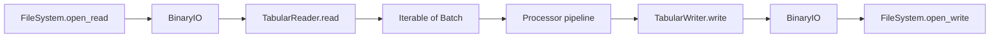
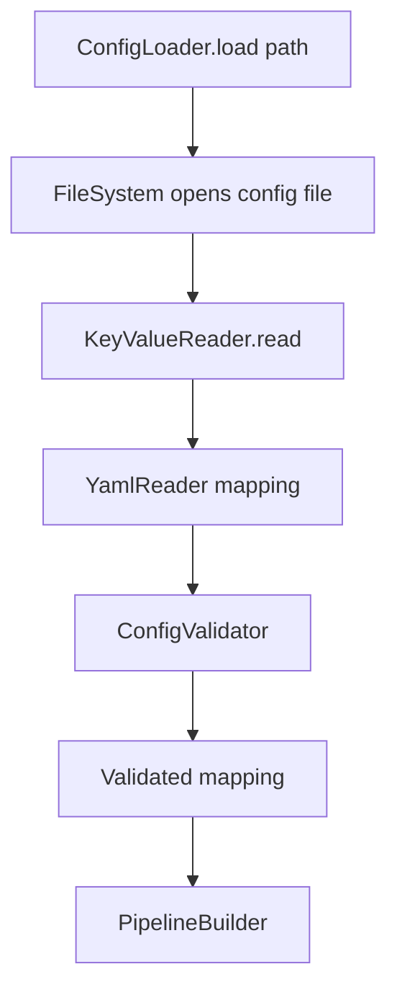
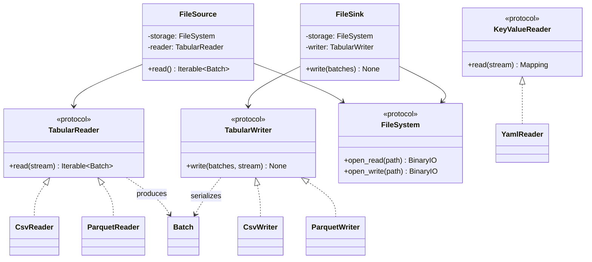

# TabularReader and TabularWriter Contracts

## Purpose

ETLRelay uses separate contracts for tabular data and mapping-shaped documents. This distinction matters now that YAML configuration is supported: a tabular reader produces `Batch` objects, while a key-value reader produces one configuration document mapping.

The public tabular protocols are `TabularReader` and `TabularWriter`. The former `Reader` and `Writer` class names are removed without aliases. Their modules remain `etlrelay.core.reader` and `etlrelay.core.writer`; `KeyValueReader` remains in `etlrelay.core.reader`.

## Tabular `TabularReader` and `TabularWriter`

`TabularReader` consumes a binary stream and produces an iterable of `Batch` objects. `TabularWriter` consumes an iterable of batches and serializes them to a binary stream. The protocols separate format-specific parsing/serialization from storage access.

`FileSource` composes a filesystem with a `TabularReader`; `FileSink` composes a filesystem with a `TabularWriter`. Readers and writers do not locate paths or validate filesystem containment. The component that opens a stream remains responsible for closing it.

Built-in tabular implementations:

| Format | TabularReader | TabularWriter | Notes |
|---|---|---|---|
| CSV | `CsvReader` | `CsvWriter` | Text format; Arrow types are inferred on reading, so exact schema round trips are not guaranteed. |
| Parquet | `ParquetReader` | `ParquetWriter` | Columnar format preserving supported Arrow schema/type information. The reader requires a seekable binary stream. The writer needs a first batch to establish schema; an empty iterable raises `WriterError`, while a zero-row batch with a schema is valid. |

`TabularFileFormatRegistry` registers the reader and writer factories independently. File-source validation asks whether a format supports reading; file-sink validation asks whether it supports writing. Capability checks do not invoke factories.

## `KeyValueReader` and `YamlReader`

`KeyValueReader` is a separate protocol used for mapping-shaped documents. Its contract returns one root mapping with string keys; it does not return batches and is not substitutable for the tabular `TabularReader` protocol.

`YamlReader` implements `KeyValueReader` and lives in `etlrelay.readers.yaml`. It uses PyYAML's safe loader and owns document-format concerns:

- Parses one YAML document from a binary stream.
- Rejects duplicate mapping keys, including collisions after YAML merge-key flattening.
- Rejects unhashable mapping keys and malformed YAML.
- Requires the root value to be a mapping with string keys.
- Leaves schema validation to `ConfigValidator`.
- Leaves stream ownership to its caller.

The reader does not know the allowed ETLRelay schema fields or supported `source`, `sink`, `processors`, `storage`, and `format` types. It parses the document without creating components, resolving environment variables, accessing configured data resources, or running a pipeline.

## Configuration data flow

The configuration file is read through the filesystem abstraction just like other file resources, but configuration parsing is a distinct boundary. Validation and pipeline construction are described in [Configuration Loading Architecture](configuration-loading.md) and [Configuration Validation Architecture](configuration-validation.md).

## What this interface does not do

Neither tabular `TabularReader`/`TabularWriter` nor `KeyValueReader` converts arbitrary row records to/from batches. A mapping-shaped document, a sequence of row mappings, and an iterable of `Batch` objects are different representations with different contracts. Generic tabular-to-record conversion is deferred beyond v1.0 and is not implied by YAML configuration support.

A future JSON document reader could implement `KeyValueReader` without changing `ConfigLoader` or the configuration schema validator. It would not need to join `TabularFileFormatRegistry`.

## Responsibilities and resource lifecycle

| Component | Responsibility | Does not own |
|---|---|---|
| `FileSystem` | Opens resource streams by path | Format parsing or transformation |
| `TabularReader` | Parses a tabular stream into batches | Opening/closing the stream or validating the path |
| `TabularWriter` | Serializes batches to a stream | Opening/closing the stream or choosing destination paths |
| `KeyValueReader` | Reads one mapping-shaped document | ETLRelay configuration schema validation |
| `YamlReader` | Safe YAML syntax and root mapping contract | ETL component construction or execution |
| `ConfigValidator` | Schema version, fields, component types, and property constraints | File/DB I/O or runtime component construction |
| `ConfigLoader` | Coordinates config-file reading and validation | Building or running a pipeline |

## Stream ownership

Readers and writers borrow streams supplied by their callers.

- `TabularReader.read(stream)` must not close the supplied input stream.
- `TabularWriter.write(batches, stream)` must not close the supplied output stream.
- This ownership rule applies to successful operations and failures.
- Direct callers must manage the streams they supply.
- `FileSource` and `FileSink` manage the streams they obtain through
  their configured `FileSystem`.

Format-specific requirements remain the responsibility of each reader
or writer. For example, Parquet reading requires an appropriately
seekable binary stream.

Readers and writers do not create directories, open paths independently,
or manage storage-backend lifetimes.

## Empty-input and schema behavior

Readers and writers implement format-specific serialization contracts.
Consequently, empty inputs and schema compatibility may behave differently
between CSV and Parquet.

| Input | `CsvWriter` | `ParquetWriter` |
|---|---|---|
| No batches | Writes no bytes | Raises `WriterError` |
| One schema-bearing zero-row batch | Writes the CSV header | Writes a valid empty Parquet file |
| Compatible batches with metadata differences | Uses CSV field names and values without preserving Arrow metadata | Accepts metadata-only differences |
| Incompatible batch schemas | Behavior depends on CSV writer validation and serialization requirements | Raises `WriterError` |

### CSV

CSV is a text-based format and does not preserve Arrow data types, field
nullability, or schema metadata.

A zero-row batch with named columns produces a CSV header without data rows.

An entirely empty iterable produces no serialized content.

### Parquet

Parquet preserves structured schema information, including Arrow data types.

The first batch establishes the output schema. Subsequent batches must
have compatible field names, order, types, and nullability.

Schema metadata differences are permitted, but the output uses the schema
established by the first batch.

A schema-bearing zero-row batch produces a valid Parquet file containing
no data rows.

An entirely empty iterable cannot establish an output schema and raises
`WriterError`.

### Pipeline validation

When readers and writers are used through `Pipeline`, the pipeline applies
its own schema compatibility checks before yielding batches to the sink.

Zero-row batches participate in this validation, and schema metadata
differences are ignored.

TabularWriter-specific serialization requirements remain in effect even when
batches have passed pipeline validation.

## Related documentation

- [YAML Configuration](../configuration.md)
- [Configuration Loading Architecture](configuration-loading.md)
- [Data Representation Contracts](data-representation-contracts.md)

## Class diagram: stream-based tabular readers and writers

The diagram below summarizes the principal types and dependencies described on this page. Existing flow, sequence, and data-flow diagrams remain part of this document.

