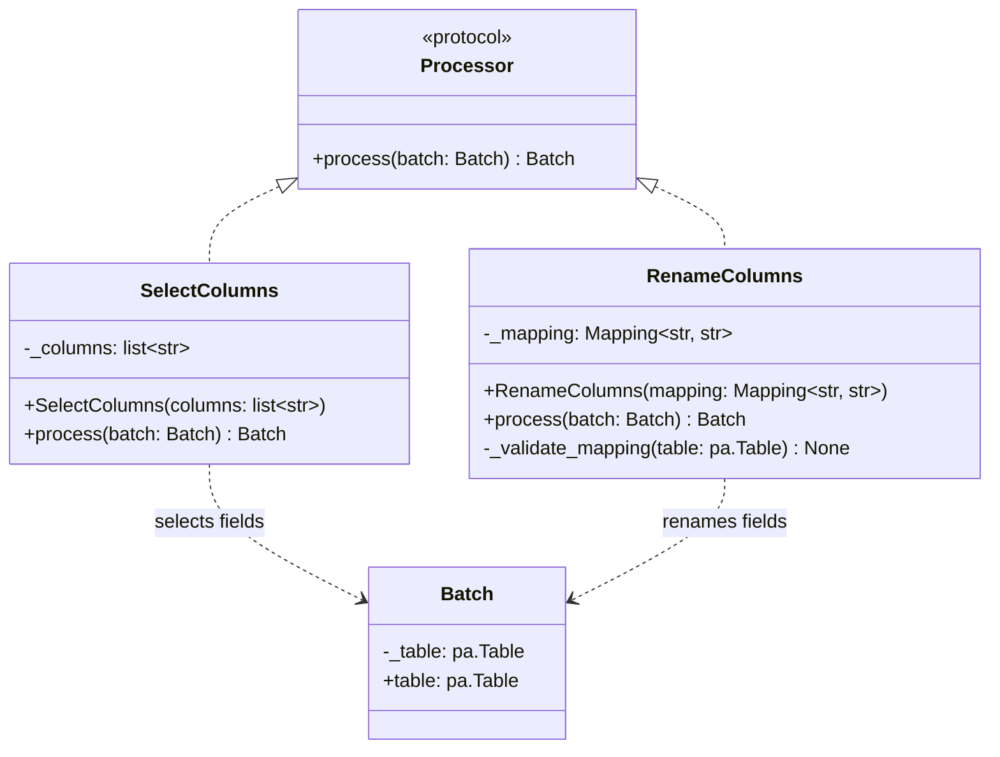

# SelectColumns and RenameColumns

## Purpose

`SelectColumns` and `RenameColumns` are built-in implementations of the existing `Processor` contract. They transform the Apache Arrow table held by a `Batch` and return a new `Batch`. Neither processor performs I/O or coordinates pipeline execution.

## Class diagram



## Responsibilities and behavior

### `SelectColumns`

`SelectColumns` selects the configured columns in the order supplied to its constructor. It preserves the selected columns' values, Arrow data types, and nullability.

It raises `ValueError` for duplicate requested names or requested names that are missing or ambiguous in the input batch. A zero-row table retains the selected schema.

### `RenameColumns`

`RenameColumns` renames columns using a mapping from existing names to new names. It preserves field order, values, data types, and nullability.

It raises `ValueError` if a source name is unknown or if the resulting column names would not be unique. Multiple columns can be renamed simultaneously, including swapping names, when all final names are unique.

## Composition

Both classes satisfy the same processor contract:

```python
process(batch: Batch) -> Batch
```

They can be used independently or sequentially. For example, `SelectColumns` can first choose and order a subset of columns, after which `RenameColumns` changes the names of the selected fields. Their order matters because each processor receives the previous processor's output.

Neither processor depends on the other. Column selection and renaming do not read files, write output, filter rows, or perform automatic type conversions.

See [Core Concepts](../concepts.md) for the batch model and [API Reference](../api-reference.md) for constructor details.
