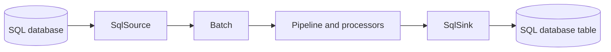
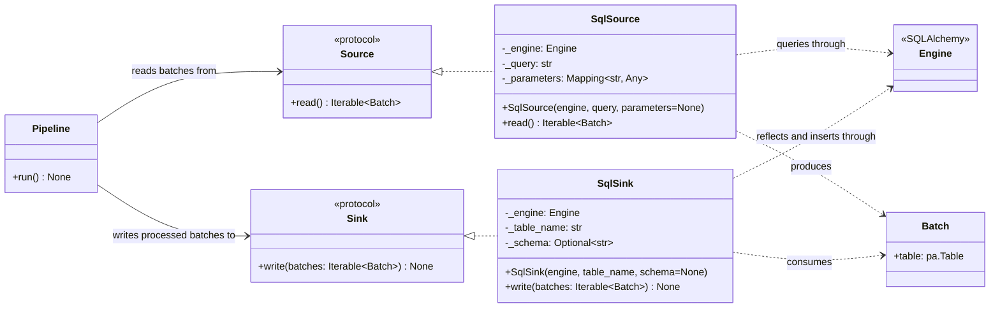

# SQL Source and Sink

## Purpose

`SqlSource` and `SqlSink` connect database I/O to ETLRelay's existing `Source` and `Sink` contracts. They are separate from `FileSource`, `FileSink`, the filesystem protocol, and file-format readers/writers. SQL components exchange the same Arrow-backed `Batch` representation used by the rest of the pipeline.



### Class diagram

The class diagram shows that the SQL components implement the existing source and sink contracts directly. They use a caller-owned SQLAlchemy `Engine`; they do not depend on the file-system, reader, or writer abstractions.



A SQL engine is created and owned by the caller. ETLRelay borrows the engine to obtain connections and transactions; it does not dispose the caller's engine.

## Public API

```python
SqlSource(
    engine,
    query,
    *,
    parameters=None,
)

SqlSink(
    engine,
    table_name,
    *,
    schema=None,
)
```

See the [API Reference](../api-reference.md) for the generated public signatures and parameter types.

### `SqlSource`

`SqlSource` executes a caller-provided SQL text query through SQLAlchemy. Optional `parameters` supplies a mapping of parameter names to values, bound through SQLAlchemy rather than interpolated into the query string.

For a query that returns rows, `SqlSource.read()` converts the result into one `Batch`. All rows are materialized before the connection is closed; the source is therefore batch-oriented, not a streaming or paginated database reader. A query returning no rows produces an empty iterable, not a zero-row batch. Duplicate result-column names are rejected because an Arrow table requires unambiguous column names.

Use named bind parameters for values:

```python
source = SqlSource(
    engine,
    "SELECT id, amount FROM orders WHERE status = :status ORDER BY id",
    parameters={"status": "ready"},
)
```

Do not build value predicates using f-strings or string concatenation. Binding protects the value boundary; it does not bind SQL syntax such as a table name, column name, operator, or sort direction.

### `SqlSink`

`SqlSink` reflects a destination table that must already exist and inserts incoming rows into it. Its supported behavior is **append only**. It does not create a table, replace a table, update or upsert existing rows, delete rows, or migrate a schema.

The names supplied by `table_name` and optional `schema` are passed to SQLAlchemy's table-reflection/insert APIs. SQLAlchemy handles dialect-specific identifier quoting for those table operations. These values are identifiers, not query-value parameters. For identifiers that originate from outside the application, validate or allowlist them before constructing the component.

Each incoming batch must have unique column names, and every batch column must match a column in the reflected destination table. Unknown target columns and duplicate batch column names raise `ValueError`. Destination columns omitted from a batch must be nullable, have a database default, or otherwise be satisfied by the database; database constraint violations propagate from SQLAlchemy/the driver.

```python
sink = SqlSink(engine, "processed_orders")
sink.write(batches)
```

The call above illustrates the API shape only; it assumes that `processed_orders` already exists and that each batch has compatible destination columns.

## Resource ownership and cleanup

The application creates the engine and remains responsible for its lifecycle, including `engine.dispose()` when the application no longer needs it.

- `SqlSource` obtains a connection for the query and closes the result and connection when reading completes or raises.
- `SqlSink` opens a transaction for each non-empty batch using SQLAlchemy's transaction context. The context commits on success and rolls back the current batch on an exception.
- ETLRelay does not close or dispose the engine passed to either component.

A typical application can share one engine between a source and a sink, including components in one pipeline, then dispose it once the pipeline and any verification queries are complete.

## Database support

The API accepts a SQLAlchemy `Engine`, so the actual connection URL, dialect, and DBAPI driver determine which database can be connected to. SQLite is the reference backend used by the automated integration tests because it is self-contained and repeatable.

The project does not currently promise equal behavior or continuous integration coverage for every SQLAlchemy dialect. A database other than SQLite needs its appropriate SQLAlchemy dialect/driver and should be verified against the queries, column types, constraints, and transaction behavior used by an application. Connection URLs may contain credentials in real deployments; examples in this documentation deliberately use in-memory SQLite and contain no credentials.

## Query values and identifiers

SQL parameters are for **values**, not identifiers. Use `:parameter_name` markers and the `parameters` mapping with `SqlSource`:

```python
SqlSource(
    engine,
    "SELECT id FROM orders WHERE customer_id = :customer_id",
    parameters={"customer_id": 42},
)
```

Do not interpolate untrusted values into SQL text. If a query needs a dynamic table name, column name, or sort order, bind parameters cannot provide it. Prefer fixed query text; otherwise construct the identifier from a trusted allowlist and use the appropriate database/dialect-aware SQLAlchemy API. `SqlSource` accepts caller-authored SQL text and is not a SQL parser, query-policy engine, or authorization boundary.

`SqlSink` receives its destination table and optional schema separately and delegates table reflection/insert statement construction to SQLAlchemy. Do not treat this as validation of an arbitrary source query or as permission to pass uncontrolled identifiers into SQL text.

## Empty-data behavior

| Input condition | `SqlSource` | `SqlSink` |
| --- | --- | --- |
| Query returns no rows | Returns no batches | Not applicable |
| Source yields no batches | The pipeline does not invoke the sink | An empty iterable performs no inserts |
| Batch has zero rows but a schema | Query results do not generate this shape for an empty query | Skips the zero-row batch without inserting rows |
| Non-empty result/batch | Returns one result batch | Inserts the batch rows if validation succeeds |

An empty iterable and a zero-row batch are distinct in the core pipeline. SQL source queries with no rows produce the former; a sink may also receive an explicitly constructed zero-row batch from another source.

## Append and transaction boundaries

`SqlSink` opens a separate transaction for every non-empty batch. Each batch is atomic within its own transaction, subject to the database and driver. A successful batch is committed before the next batch's transaction is started.

Consequently, if a pipeline writes several batches and a later batch fails, earlier successfully committed batches remain in the destination. ETLRelay does not provide one transaction across an entire pipeline or a whole iterable of batches. A retry performed by an application may append rows again unless the application has separately designed an idempotency strategy; ETLRelay does not retry automatically.

## Limitations and out-of-scope behavior

- **No replace mode:** writes append rows only. There is no `replace` argument or table truncation behavior.
- **No table creation or schema migration:** the destination table must pre-exist with a compatible schema.
- **No ORM integration:** SQLAlchemy ORM models and sessions are not part of these component contracts.
- **No automatic retries:** connection, query, constraint, and write failures propagate to the caller.
- **No pipeline-wide transaction:** transactions are scoped to individual non-empty sink batches.
- **No database-specific bulk strategy or pagination guarantee:** a non-empty source query is materialized as one batch, so large query results may require significant memory.
- **No universal dialect guarantee:** SQLite is the continuously exercised integration backend; other configured SQLAlchemy dialects need application-level verification.
- **No automatic credential management or authorization layer:** the caller is responsible for configuring connections, managing secrets, and limiting database permissions.

These limits are deliberate. Additional write modes, ORM support, migrations, retries, pagination, and broader database integration should be introduced only with explicit requirements and corresponding tests.
