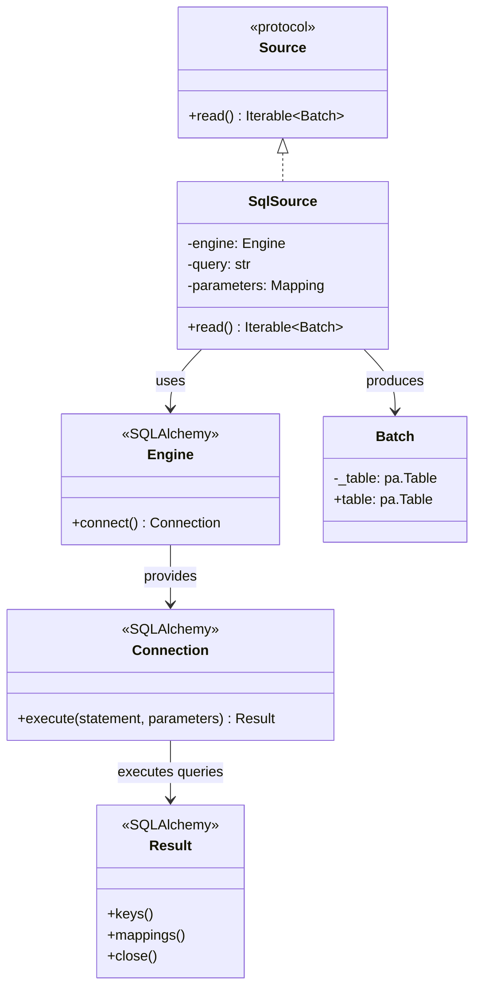
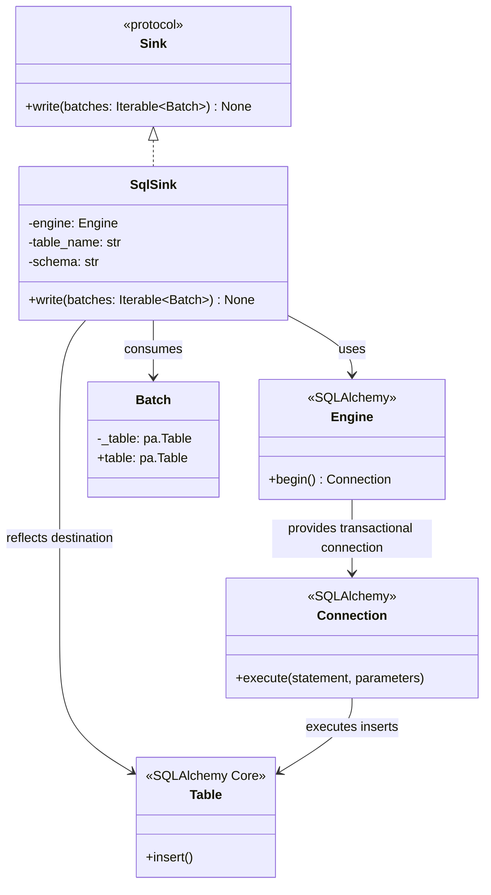

# SQL Source and Sink

## Purpose

`SqlSource` and `SqlSink` are independent components that integrate SQL databases into ETLRelay pipelines.

- `SqlSource` executes a SQL query and converts its results into ETLRelay batches.
- `SqlSink` writes ETLRelay batches to an existing SQL table.

Both components use SQLAlchemy's connection and statement facilities and the existing Arrow-backed `Batch` representation. They implement the `Source` and `Sink` protocols without changing the core pipeline architecture.

The initial implementation supports SQLite for repeatable integration testing. Other database dialects may work through SQLAlchemy, but their behavior is not considered verified until tested.

SQL components do not depend on `FileSystem`, `Reader`, or `Writer`. Database access, query execution, and transaction management belong to the respective SQL components.

## Class Diagrams

### SqlSource



### SqlSink



The diagrams show the main architectural dependencies, not the complete SQLAlchemy API.

## Responsibilities

### SqlSource

`SqlSource` is responsible for:

- Storing the supplied SQLAlchemy engine, SQL query, and optional parameter mapping.
- Acquiring a connection through the supplied engine.
- Executing the query through SQLAlchemy's statement facilities.
- Binding query parameter values without interpolating them into the SQL string.
- Converting query results into a PyArrow table and wrapping that table in a `Batch`.
- Returning the resulting batch through the `Source` protocol.
- Closing result and connection resources on both success and failure.
- Propagating query execution and data-conversion exceptions.

`SqlSource` is **not** responsible for:

- Creating or disposing of the supplied engine.
- Constructing arbitrary queries from table or column configuration.
- Managing database schemas or migrations.
- Applying pipeline processors.
- Writing query results to a database or file.
- Providing streaming or bounded-memory query execution in the initial implementation.
- Introducing a separate database abstraction or exception hierarchy.

### SqlSink

`SqlSink` is responsible for:

- Storing the supplied SQLAlchemy engine and destination table configuration.
- Resolving the destination table through SQLAlchemy Core table and reflection facilities.
- Converting batch data into values suitable for SQLAlchemy execution.
- Validating incoming field names against the destination table's columns.
- Appending rows to the existing destination table.
- Managing a transaction for each non-empty batch.
- Committing successful batch writes and rolling back failed batch writes.
- Propagating database and data-conversion exceptions.

`SqlSink` is **not** responsible for:

- Creating or disposing of the supplied engine.
- Creating or migrating destination tables.
- Truncating, dropping, or replacing destination tables.
- Generating arbitrary SQL by interpolating caller-supplied identifiers.
- Transforming batches or orchestrating pipeline execution.
- Managing transactions across the entire pipeline.
- Introducing a separate database abstraction, retry framework, or exception hierarchy.

### SQLAlchemy Engine

The supplied `Engine` provides database connectivity and access to SQLAlchemy's execution and transaction facilities.

The caller creates and owns the engine, including its connection configuration and credentials.

SQL components borrow the engine and manage only the connections, results, and transactions they create. They do not dispose of the caller's engine.

### Batch Conversion

Both components use the existing `Batch` contract, which wraps a `pyarrow.Table`.

`SqlSource` converts database result values to Python-native values and constructs an Arrow table. Arrow infers data types from those values.

`SqlSink` converts the Arrow table into Python records using its existing values and column names, then submits those records to SQLAlchemy for insertion.

The initial implementation does not define a separate database-to-Arrow type-mapping layer. In particular, a result column containing only null values may be inferred as Arrow's `null` type.

## Dependency Relationship

```text
Source
  ▲
  │ implements
  │
SqlSource
  ├── SQLAlchemy Engine
  │      └── Connection
  │             └── Result
  │
  └── Batch
         └── PyArrow Table


Sink
  ▲
  │ implements
  │
SqlSink
  ├── SQLAlchemy Engine
  │      └── Connection / Transaction
  │
  ├── SQLAlchemy Core Table
  │
  └── Batch
         └── PyArrow Table
```

Both implementations depend on the existing core contracts and SQLAlchemy facilities. Neither requires changes to `Source`, `Sink`, `Batch`, or `Pipeline`.

There is no additional `SqlReader`, `SqlWriter`, database adapter protocol, or generalized database service. These abstractions are unnecessary for the initial implementation.

## Data Flow

### SqlSource

```text
SqlSource.read()
       │
       ▼
Engine.connect()
       │
       ▼
Execute SQL statement
with bound parameters
       │
       ▼
SQLAlchemy Result
       │
       ▼
Materialize result rows
       │
       ▼
PyArrow Table
       │
       ▼
      Batch
       │
       ▼
Iterable[Batch]
```

`SqlSource` executes a caller-supplied, row-returning SQL query through SQLAlchemy.

Query values are supplied through named bind parameters. For example:

```python
SqlSource(
    engine,
    "SELECT id, name FROM users WHERE status = :status",
    parameters={"status": "active"},
)
```

The query remains caller-authored. `SqlSource` does not construct SQL identifiers or interpolate parameter values into query strings.

For the initial implementation, the complete result is materialized in memory and returned as one batch when rows are present. If the query returns no rows, `read()` returns an empty iterable rather than a zero-row batch.

The result and connection are closed before `read()` returns its iterable. This prevents resource lifetime from depending on how the caller subsequently consumes the iterable.

This implementation intentionally does not provide incremental result fetching. Large-result streaming can be considered separately when a concrete requirement justifies it.

### SqlSink

```text
SqlSink.write(batches)
          │
          ▼
 Iterate over batches
          │
          ▼
   Skip zero-row batches
          │
          ▼
 Begin transaction
          │
          ▼
 Resolve destination table
through SQLAlchemy Core
          │
          ▼
 Validate incoming columns
          │
          ▼
 Convert rows and execute
      INSERT
          │
          ▼
     ┌────┴────┐
     │         │
  Success    Failure
     │         │
   Commit    Rollback
     │         │
     └────┬────┘
          ▼
 Process next batch
```

`SqlSink` processes the supplied iterable sequentially. It does not buffer the entire iterable before writing.

Each non-empty batch is handled in its own transaction. The destination table is resolved lazily when the first non-empty batch is encountered and its reflected metadata is reused for subsequent batches in the same `write()` call.

A successful transaction commits the batch. A failed insertion or validation operation rolls back the current transaction and propagates the original exception.

Earlier committed batches are not rolled back if a later batch fails. The sink does not provide a transaction spanning the complete iterable or pipeline.

## Interface

### SqlSource

```python
from collections.abc import Iterable, Mapping
from typing import Any

from sqlalchemy.engine import Engine

from etlrelay.core import Batch


class SqlSource:
    def __init__(
        self,
        engine: Engine,
        query: str,
        *,
        parameters: Mapping[str, Any] | None = None,
    ) -> None:
        ...

    def read(self) -> Iterable[Batch]:
        ...
```

The `parameters` mapping contains values for named bind parameters in the SQL statement. It is optional when the query does not require parameters.

The query must return rows. Statements that do not return a result set are outside the `SqlSource` contract.

### SqlSink

```python
from collections.abc import Iterable

from sqlalchemy.engine import Engine

from etlrelay.core import Batch


class SqlSink:
    def __init__(
        self,
        engine: Engine,
        table_name: str,
        *,
        schema: str | None = None,
    ) -> None:
        ...

    def write(self, batches: Iterable[Batch]) -> None:
        ...
```

`table_name` identifies an existing destination table. `schema` optionally identifies its database schema.

The initial sink supports append-only writes. A separate write-mode argument is unnecessary while no other mode is implemented.

## Contract

### SqlSource

| Operation | Expected behavior |
|---|---|
| Construct with engine and query | Stores the supplied configuration without taking ownership of the engine |
| Supply named parameters | Binds values through SQLAlchemy rather than interpolating them into the query |
| Read a query returning rows | Returns one batch containing the complete result |
| Read an empty result set | Returns an empty iterable, not a zero-row batch |
| Read a result containing nulls | Preserves null values |
| Read a result with duplicate column names | Raises a clear error rather than silently losing values |
| Execute a non-row-returning statement | Raises a clear error |
| Encounter a database or conversion error | Propagates the original exception |
| Complete or fail a read | Closes the result and connection resources |
| Receive another compatible SQLAlchemy engine | Uses the supplied engine without disposing of it |

### SqlSink

| Operation | Expected behavior |
|---|---|
| Construct with engine and table name | Stores the supplied configuration without taking ownership of the engine |
| Write non-empty batches | Appends rows to the existing destination table |
| Write multiple batches | Processes batches sequentially, with one transaction per non-empty batch |
| Write an empty iterable | Performs no database writes |
| Write a zero-row batch | Performs no database writes for that batch |
| Supply fields not present in the destination table | Raises a clear error and rolls back the current batch transaction |
| Omit destination columns | Allows database defaults and constraints to determine whether the insert is valid |
| Write to a missing or inaccessible table | Propagates the underlying error |
| Encounter an insertion failure | Rolls back the current batch and propagates the original exception |
| Complete a successful batch | Commits that batch's transaction |
| Fail after earlier batches committed | Preserves earlier commits; does not roll back the entire operation |
| Complete or fail a batch write | Closes the connection and transaction resources it manages |
| Supply another SQLAlchemy-compatible engine | Uses the supplied engine without modifying the component's public interface |

### Exception Behavior

Exceptions are propagated rather than wrapped in new `SqlSource` or `SqlSink` exception hierarchies.

This follows ETLRelay's existing pipeline behavior. SQLAlchemy and driver exceptions remain available to the caller, and the pipeline is not responsible for database-specific error handling.

For `SqlSink`, transaction context management ensures that a failed batch does not leave a partially committed transaction. It does not reverse batches that have already committed.

### SQL Safety

SQL query values must use SQLAlchemy bound parameters. Interpolating untrusted values directly into SQL strings is outside the supported safe usage.

Table and schema identifiers cannot be bound as ordinary SQL values. `SqlSink` therefore uses SQLAlchemy Core `Table` construction and reflection to resolve destination identifiers, instead of generating SQL statements by interpolating those identifiers into strings.

Incoming batch field names are matched against the reflected table columns. The database remains responsible for enforcing column types, nullability, constraints, and other schema rules.

The sink requires an existing destination table. It does not create, truncate, drop, or replace tables.

### Empty-Data Semantics

An empty query result and a zero-row batch represent different conditions:

- **Empty query result:** `SqlSource.read()` returns no batches. Consequently, the pipeline has no SQL data batches to process.
- **Zero-row batch:** A valid `Batch` with zero rows is passed through the pipeline according to its existing contract. `SqlSink` treats it as a no-op.

An empty batch iterable also results in no database writes or destination-table reflection.

## SOLID Considerations

### Single Responsibility Principle

`SqlSource` retrieves database rows and converts them into the common batch representation.

`SqlSink` validates and writes batch data to a database table using transactional inserts.

Neither component is responsible for pipeline orchestration, general-purpose query generation, or managing database schemas.

### Open/Closed Principle

Additional database integrations can be introduced through SQLAlchemy-compatible engines without changing `Pipeline`, `Source`, or `Sink`.

Additional source and sink implementations can also be introduced independently. No factory, registry, or plugin mechanism is required for the initial SQL implementation.

### Liskov Substitution Principle

`SqlSource` and `SqlSink` implement the existing source and sink protocols. They can therefore be used by `Pipeline` in place of other compatible implementations.

They must preserve batch order, exception propagation, and the common `Batch` interface. Database-specific transaction behavior is documented by `SqlSink` and does not imply pipeline-wide transactions.

### Interface Segregation Principle

The SQL components implement only the small existing `Source` and `Sink` protocols.

There are no unrelated methods for opening connections, disposing of engines, transforming data, managing migrations, or configuring pipeline execution added to those protocols.

### Dependency Inversion Principle

`Pipeline` continues to depend on `Source`, `Processor`, and `Sink`, rather than concrete SQL implementations.

The SQL components accept an injected SQLAlchemy engine rather than constructing their own engine or embedding connection configuration. This keeps connection ownership explicit and supports testing against SQLite.

## Design Constraints

The initial implementation should remain small:

- Implement `SqlSource` and `SqlSink` in separate modules under `etlrelay.sources` and `etlrelay.sinks`.
- Use SQLAlchemy 2.x connection, statement, transaction, and Core table facilities.
- Keep SQL-specific behavior out of file storage and reader/writer abstractions.
- Use named bind parameters for SQL query values.
- Use SQLAlchemy Core constructs for table and schema identifiers.
- Materialize query results into one batch rather than implementing streaming.
- Require destination tables to exist.
- Support append-only writes with one transaction per non-empty batch.
- Preserve exception propagation and reliably close managed resources.
- Use SQLite for repeatable source, sink, transaction, and pipeline integration tests.
- Export `SqlSource` and `SqlSink` from their respective package namespaces.
- Avoid changes to the existing core protocols or batch model.
- Defer replacement writes, ORM integration, schema migrations, automatic retries, and distributed transactions until concrete requirements justify them.

The central design principle is:

**`SqlSource` coordinates query execution and conversion into batches; `SqlSink` coordinates batch validation and transactional insertion. SQLAlchemy handles database execution, while ETLRelay's existing batch and pipeline contracts remain unchanged.**