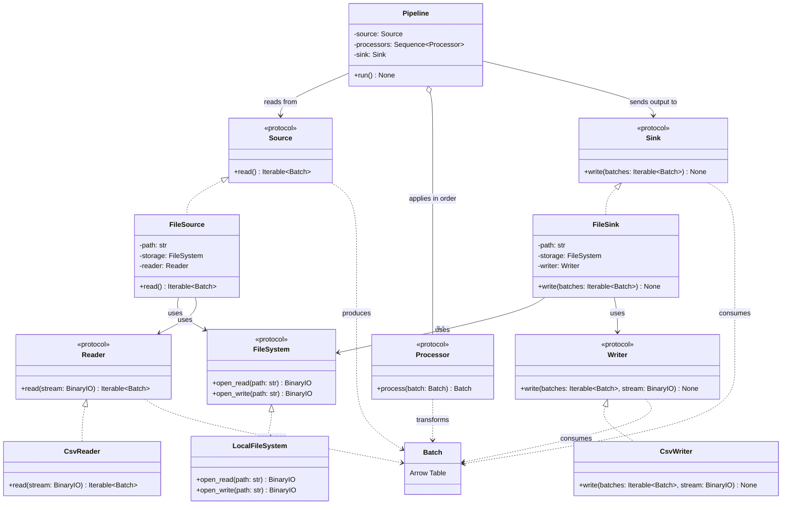

# ETLRelay Batch and Pipeline Contracts

## Purpose

ETLRelay processes data as a sequence of `Batch` objects, with each batch represented using Apache Arrow. A `Pipeline` coordinates a source, an ordered sequence of processors, and a sink.

The purpose of this design is to establish the existing contracts and clarify the distinction between an empty source iterable and a batch containing a zero-row Arrow table.

The diagram documents the existing component boundaries. It does not introduce new abstractions or require changes to behavior that is already correct.

## Class Diagram

## Responsibilities

### Batch

`Batch` represents a unit of data processed by ETLRelay and backed by an Apache Arrow table.

The audit must establish whether the existing implementation preserves the table's values and schema, including field names, field order, types, and nullability.

A zero-row Arrow table remains a `Batch` with a schema. It must not be treated as equivalent to an empty iterable containing no batches.

### Pipeline

`Pipeline` coordinates execution between the source, processors, and sink.

It is responsible for applying processors in their configured order and passing the resulting batches to the sink. The audit must verify existing execution behavior, including exception propagation and how empty inputs are handled.

### Source and Reader

`Source` defines how a pipeline obtains batches. A file-based source composes a storage implementation with a reader.

`Reader` handles format-specific deserialization. `CsvReader` is the existing CSV implementation relevant to this ticket.

The audit must distinguish a reader producing no batches from one producing a batch backed by a zero-row Arrow table.

### Processor

`Processor` defines the transformation contract:

`process(batch: Batch) -> Batch`

The audit must verify that processors receive individual batches, execute in the configured order, and propagate exceptions. Implementing new processors is outside this issue's scope.

### Sink and Writer

`Sink` defines how a pipeline's output batches are consumed. A file-based sink composes a storage implementation with a writer.

`Writer` handles format-specific serialization. `CsvWriter` is the existing CSV implementation relevant to this ticket.

The audit must verify empty-input behavior, zero-row batch behavior, repeated write behavior, and exception propagation without duplicating responsibilities between the sink and writer.

## Contract Verification

| Scenario | Behavior to verify |
|---|---|
| Normal batch | Values and Arrow schema are preserved where no transformation is applied. |
| Zero-row Arrow table | The batch retains its schema and follows the normal processing path. |
| Empty source iterable | No processor calls or sink writes occur, if this is the existing agreed contract. |
| Multiple batches | Processors execute in configured order and batches reach the sink in the expected order. |
| Repeated sink writes | Existing invocation and serialization behavior is identified and tested. |
| Source, processor, or sink failure | The original exception propagates unless the existing public contract specifies otherwise. |

## Design Constraints

The implementation should remain small:

- Audit the current classes and protocols before proposing changes.
- Add focused tests for behavior that is missing or unclear.
- Preserve existing public APIs and correct behavior.
- Do not introduce schema-validation machinery or new abstractions in this issue.
- Record the verified contract in the existing documentation.

The central design principle is:

Define and test the behavior of the existing components before changing their architecture or introducing new processors.