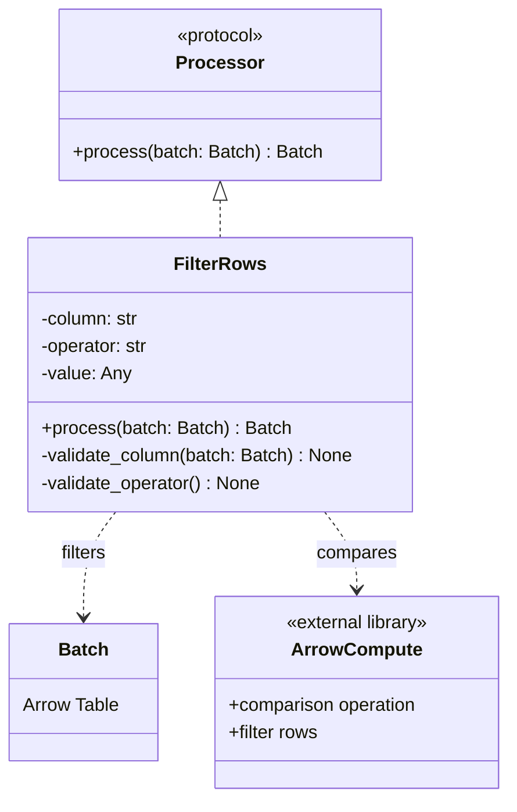

# ETLRelay FilterRows Processor

## Purpose

`FilterRows` filters rows in a `Batch` using a single column comparison predicate implemented with Apache Arrow compute operations.

The processor accepts a column name, a comparison operator, and a comparison value. It supports six operators: `==`, `!=`, `<`, `<=`, `>`, and `>=`.

The purpose of this design is to define a small, predictable filtering interface that preserves the input schema and integrates with the existing `Processor` contract.

The design introduces no new abstractions, expression language, or automatic custom casting.

## Class Diagram

## Responsibilities

### FilterRows

`FilterRows` implements the existing processor contract:

`process(batch: Batch) -> Batch`

It stores the configured column name, comparison operator, and comparison value. For each batch, it validates the requested column and operator, performs the comparison using Apache Arrow compute operations, and returns a new `Batch` containing only the matching rows.

The processor must:

- Support `==`, `!=`, `<`, `<=`, `>`, and `>=`.
- Reject unknown column names and unsupported operators with clear `ValueError` exceptions.
- Preserve the original schema, including field names, order, types, and nullability.
- Exclude rows where the comparison evaluates to null.
- Avoid retaining batch-specific state between calls.

### Batch

`Batch` represents the input and output data using an Apache Arrow table.

Filtering changes which rows are included but must not change the table's schema. This applies when no rows match, when every row matches, and when the input already contains zero rows.

### Apache Arrow Compute

Apache Arrow compute operations perform the comparison and filter the table using the resulting boolean mask.

The implementation must not introduce implicit custom casting. Incompatible comparison types must produce predictable, tested errors rather than silently coercing values.

## Contract Verification

| Scenario | Expected behavior |
|---|---|
| Supported operator | Correctly filters rows for each of the six operators. |
| Unknown column | Raises `ValueError` with a clear message. |
| Unsupported operator | Raises `ValueError` identifying the unsupported operator. |
| Incompatible comparison types | Produces a predictable, tested error without custom casting. |
| Null comparison result | Excludes the corresponding row. |
| No rows match | Returns a zero-row batch with the original schema. |
| Zero-row input | Returns a zero-row batch with the original schema. |
| All rows match | Returns all rows with the original schema preserved. |
| Repeated calls | Each batch is filtered independently; no state carries over. |

## Design Constraints

The implementation should remain small:

- Use Apache Arrow compute operations for comparisons and filtering.
- Keep the existing `Processor` interface unchanged.
- Export `FilterRows` through the existing public processor API.
- Document the supported operators, null behavior, and type compatibility.
- Use focused tests for each operator and relevant edge cases.
- Do not introduce expression parsers, nested predicates, arbitrary functions, or custom casting.

The central design principle is:

**Filter rows using a single, explicit comparison predicate while preserving the existing batch contract and keeping processor behavior stateless.**