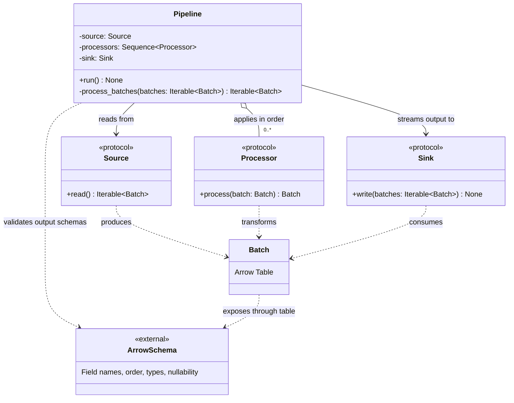

# ETLRelay Pipeline Output Schema Contract

## Purpose

`Pipeline` coordinates a source, an ordered sequence of processors, and a sink. This change establishes a consistent output schema across all batches produced during a pipeline run.

The first processed output batch establishes the expected schema. Every subsequent processed batch must have compatible field names, field order, Arrow field types, and nullability. Schema metadata differences are ignored.

The design extends the existing `Pipeline` behavior without introducing new abstractions, automatic schema reconciliation, or buffering.

## Class Diagram

## Responsibilities

### Pipeline

`Pipeline` remains responsible for coordinating batch processing and output delivery.

For each batch, it applies processors in their configured order and validates the resulting batch schema before yielding that batch to the sink.

The first processed output batch establishes the expected schema for the current run. Subsequent output batches are checked against it. This validation must happen incrementally, without collecting batches in memory.

The expected schema is run-specific state, not persistent state shared between separate pipeline runs.

### Batch

`Batch` continues to represent a unit of data backed by an Apache Arrow table.

Schema validation uses the processed output table's schema, rather than the original input schema. This allows processors to normalize different input schemas into a compatible output schema.

Zero-row batches remain valid batches and participate in schema validation like any other batch.

### Processor

`Processor` retains its existing contract:

`process(batch: Batch) -> Batch`

Processors execute in their configured order for every batch. This ticket does not change the processor interface or require processors to share state.

### Source and Sink

`Source` continues to produce batches, while `Sink` consumes the processed output.

The pipeline must validate each output schema before passing the corresponding batch to the sink. If a later batch fails validation, the error propagates and that incompatible batch is not written.

Batches successfully written before a later failure are not rolled back.

## Contract Verification

| Scenario | Expected behavior |
|---|---|
| Processor ordering | Processors execute in configured order for each batch. |
| Multiple input batches | Processor ordering remains consistent across batches. |
| Zero-row batch | The batch reaches processors and participates in schema validation. |
| First processed output batch | Establishes the expected schema for the run. |
| Different field names | Raises a clear schema mismatch error. |
| Different field order | Raises a clear schema mismatch error. |
| Different Arrow field types | Raises a clear schema mismatch error. |
| Different field nullability | Raises a clear schema mismatch error. |
| Different schema metadata | Does not cause a schema mismatch. |
| Incompatible later batch | Fails before that batch reaches the sink. |
| Earlier successful writes | Remain written if a later batch fails. |
| Different input schemas normalized by processors | Accepted when the processed output schemas are compatible. |
| New pipeline run | Establishes its own expected schema. |

## Design Constraints

The implementation should remain small:

- Extend the existing pipeline processing path with output schema validation.
- Use the first processed output batch as the schema reference.
- Compare schemas without considering metadata.
- Validate batches incrementally before they are passed to the sink.
- Preserve existing processor ordering, exception propagation, and empty-source behavior.
- Do not introduce automatic schema merging, implicit casting, general-purpose buffering, or rollback infrastructure.

The central design principle is:

**Validate every processed output batch against the first output schema while preserving the pipeline's existing streaming behavior and component boundaries.**