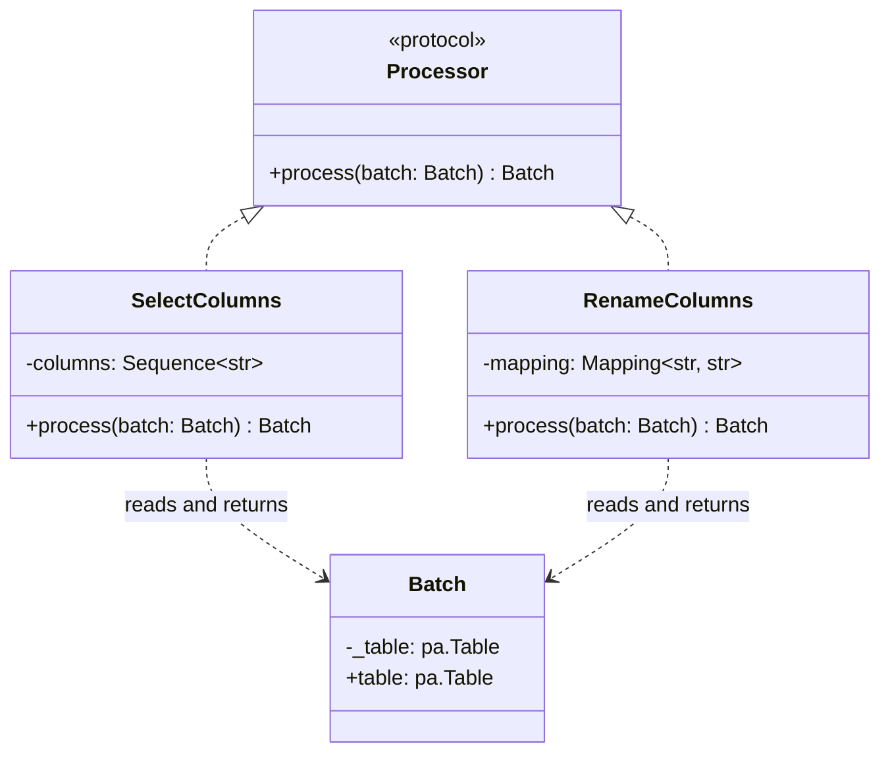

# SelectColumns and RenameColumns

## Purpose

`SelectColumns` and `RenameColumns` are built-in ETLRelay processors for selecting and renaming columns within a `Batch`.

Both processors use the existing interface:

`process(batch: Batch) -> Batch`

They operate on the Apache Arrow table contained in the input batch and return a new `Batch` with the requested transformation applied. They do not perform I/O, orchestrate pipeline execution, or introduce additional processor abstractions.

## Class Diagram



## Responsibilities

### SelectColumns

`SelectColumns` is responsible for:

- Storing the requested column names.
- Selecting the requested columns from the input batch.
- Preserving the order specified by the caller.
- Preserving the selected fields' values, Arrow types, and nullability.
- Rejecting unknown or duplicate requested column names with a clear error.
- Preserving the selected schema when the input table contains zero rows.

`SelectColumns` is **not** responsible for:

- Renaming columns.
- Converting data types.
- Reading or writing files.
- Orchestrating pipeline execution.
- Transforming nested fields.

### RenameColumns

`RenameColumns` is responsible for:

- Storing the mapping between existing column names and their new names.
- Renaming the requested fields while preserving the original field order.
- Preserving field values, Arrow types, and nullability.
- Rejecting unknown source column names.
- Rejecting mappings that would result in duplicate final column names, including collisions with columns that are not being renamed.
- Preserving the resulting schema when the input table contains zero rows.

`RenameColumns` is **not** responsible for:

- Selecting or removing columns.
- Converting data types.
- Reading or writing files.
- Orchestrating pipeline execution.
- Applying arbitrary expressions or transformations.

## Dependency Relationship

```text
Processor
    ▲
    ├── SelectColumns
    │       └── Batch
    │
    └── RenameColumns
            └── Batch
```

Both processors implement the same `Processor` protocol and operate on `Batch`.

Neither processor depends on the other. They can be used independently or composed in a pipeline, with `SelectColumns` followed by `RenameColumns` when that order is appropriate.

## Data Flow

```text
Input Batch
    │
    ▼
SelectColumns
    │
    ▼
Selected Batch
    │
    ▼
RenameColumns
    │
    ▼
Renamed Batch
```

`SelectColumns` determines which fields remain and their order. `RenameColumns` changes field names without changing field order or data.

Each processor receives a `Batch` and returns a `Batch`. Composition uses the existing processor interface; no additional base class or orchestration component is required.

## Design Constraints

The initial implementation should remain small:

- Use the existing `Processor` protocol.
- Use Apache Arrow operations for column selection and renaming.
- Follow established project conventions for constructors, typing, exceptions, and public exports.
- Validate invalid and ambiguous column specifications clearly.
- Preserve types, nullability, values, and the expected schema for zero-row tables.
- Add unit tests before implementing each behavior.
- Avoid additional abstractions, automatic type conversions, and unrelated pipeline changes.

The constructor attributes in the diagram represent the intended configuration: a sequence of column names for `SelectColumns` and a mapping of old names to new names for `RenameColumns`. Their exact signatures should follow the project's existing conventions.

**The central design principle is that each processor performs one focused transformation and implements the same existing interface.**